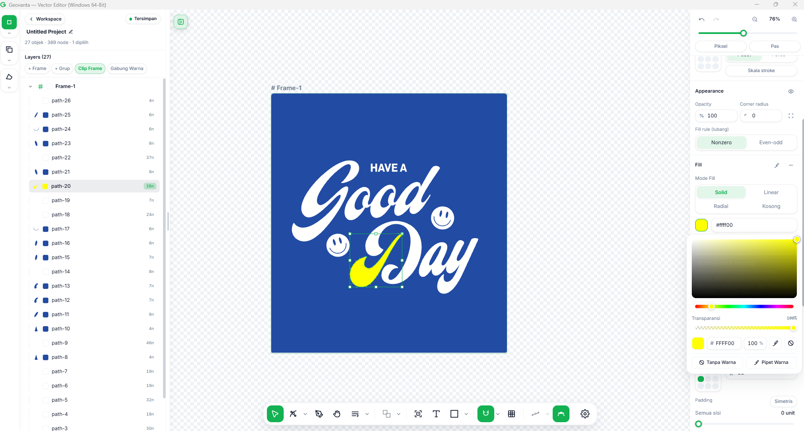
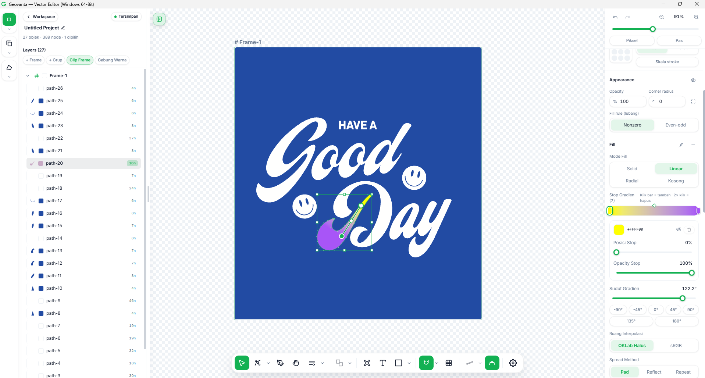
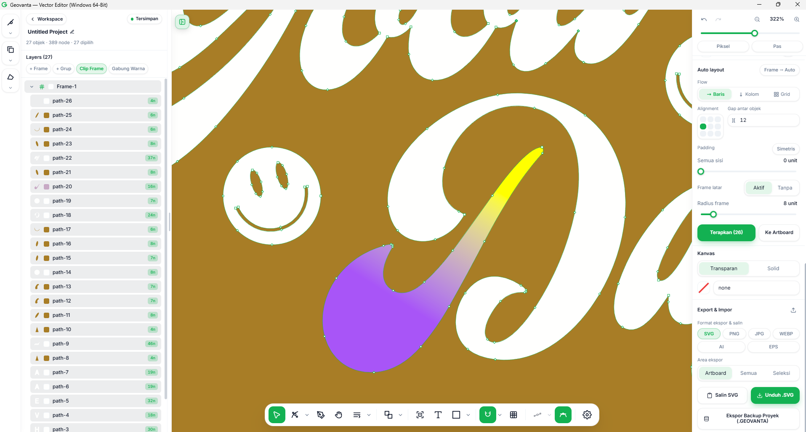
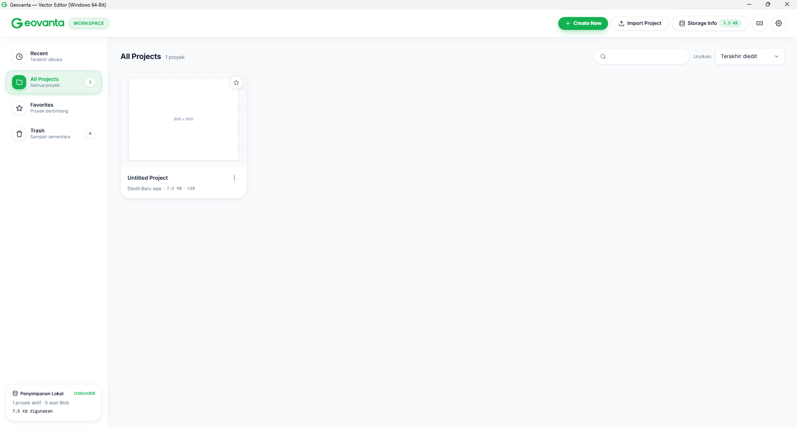
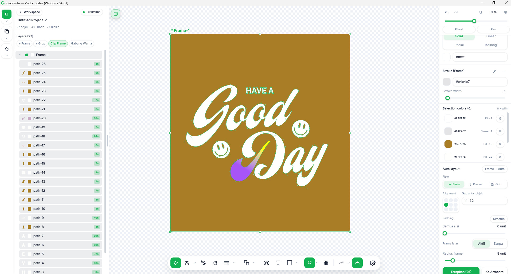
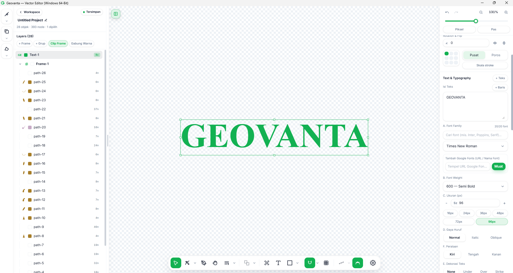
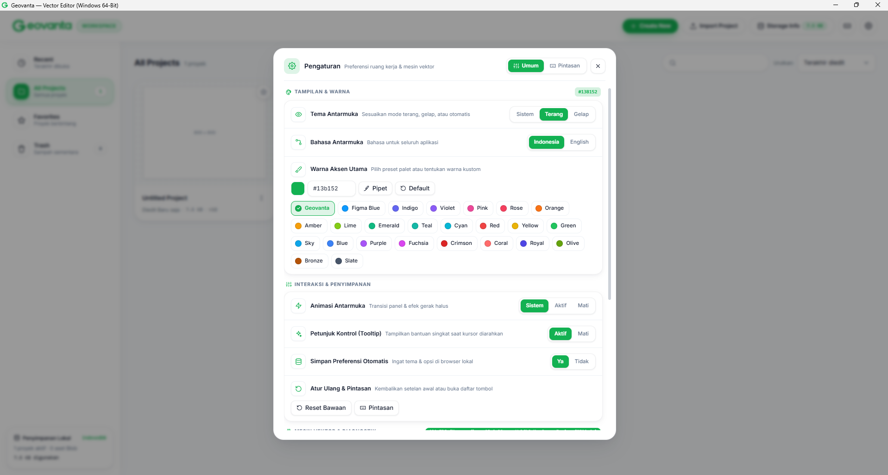
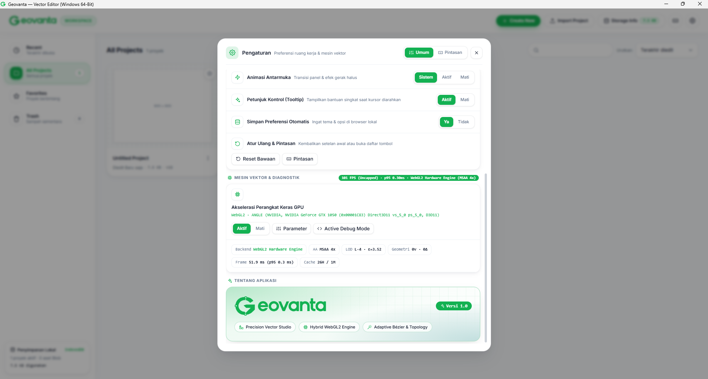

<p align="center">🌐 <b>English</b> · <a href="README.md">Bahasa Indonesia</a></p>

<p align="center">
  
</p>

<h1 align="center">Geovanta Vector Studio</h1>

<p align="center">
  <b>Desktop vector editor for Windows 64-bit — fast, precise, and 100% offline.</b><br>
  Create logos, icons, illustrations, and vector artwork with no internet, no subscription, and no CDN loading.
</p>

<p align="center">
  
  
  
  
  
</p>

<p align="center">
  
  <br><em>Editing artwork in Geovanta — layers, colors, and canvas on one screen.</em>
</p>

---

## ✨ Why Geovanta?

| | |
|---|---|
| 🖥️ **A real desktop app, not a website** | Rust + Tauri v2. Lightweight, native, and your files stay on your computer. |
| 🔌 **100% offline** | No CDN, no account, no server. React & Tailwind are bundled locally. |
| 🎯 **Figma-grade precision** | Smart snapping, equal spacing, and alignment guides that feel natural. |
| ✂️ **Full Pathfinder** | Boolean, Outline Stroke, and Offset Path — features usually found only in paid editors. |
| 🌐 **Indonesian & English** | The entire interface and all 303 tooltips are available in both languages. |
| ⚡ **GPU acceleration** | WebGL2 vector engine with MSAA 4x — the canvas stays smooth even when zoomed in. |

## 🚀 Key Features

### 🎨 Drawing & Editing Vectors
- **Bézier node editing** — edit points, handles, and curves with full control, up to 322% zoom
- **Shapes, text, and gradients** — ready-made shapes, text with Google Fonts, and a gradient gizmo right on the canvas (Linear / Radial, OKLab & sRGB)
- **Frames & Auto Layout** — arrange components like in Figma: Row / Column / Grid, alignment, gap, and padding
- **Simplify, fillet, and straighten** — clean up messy paths in one click

<p align="center">
  
  
  <br><em>A linear gradient with its on-canvas gizmo, and Bézier nodes that stay sharp at 322% zoom.</em>
</p>

### ✂️ Boolean / Pathfinder
Combine, cut, and slice shapes however you like — from the floating bar, the context menu, or a shortcut:

| Operation | Shortcut | Result |
|---|---|---|
| **Union** | `Ctrl+Alt+U` | Merge 2+ shapes into one |
| **Subtract** | `Ctrl+Alt+S` | Cut the top shape out of the bottom one |
| **Intersect** | `Ctrl+Alt+I` | Keep the intersection of both shapes |
| **Exclude** | `Ctrl+Alt+X` | Remove the intersection, keep the rest |
| **Outline Stroke** | `Ctrl+Alt+O` | Turn a stroke into a filled shape |
| **Offset Path** | context menu | Expand / contract a path by −100…+100 pt, Miter / Bevel / Round joins, live preview |

### 🧲 Figcraft-style Snapping
- A 5 px snap that feels just right — not too aggressive, not too loose
- **Equal spacing** between objects is detected automatically
- Hold `Ctrl` / `Cmd` to temporarily disable snapping when you need freedom

### 🗂️ Workspace & Layers
- Project management with automatic thumbnails, favorites, and trash
- An optimized layer panel — scrolling stays smooth in large projects (27 objects, 389 nodes in the example below)
- Local storage (IndexedDB) and crash recovery, no cloud

<p align="center">
  
  
  <br><em>The workspace with project cards, and a Frame with Auto Layout + Selection Colors.</em>
</p>

### 🔤 Text & Typography
- Font family, weight, size, style (Normal / Italic / Oblique), and text decoration
- Add Google Fonts via URL, right from the inspector panel

<p align="center">
  
  <br><em>GEOVANTA text — Times New Roman, 96 px, Semi Bold.</em>
</p>

### 🎛️ Settings You Can Tweak
- Light / Dark / System theme, Indonesian / English language
- **25 accent colors** — from Geovanta `#13b152` to Figma Blue, Indigo, Violet, and Slate — plus a custom color picker
- Interface animations, tooltips, and automatic preference saving

<p align="center">
  
  
  <br><em>Appearance & accent color settings, plus the GPU vector engine and the About page — Version 1.0.</em>
</p>

### 📁 Import & Export
- Export **SVG, PNG, JPG, WEBP, AI, EPS** — per Artboard, All, or Selection
- Copy SVG directly, and export a project backup (`.GEOVANTA`)

## 📥 Installation

### Option 1 — Windows Installer (easiest)
1. Build the installer on a 64-bit Windows PC with Rust installed, then run:
   ```bat
   build-windows-64bit.bat
   ```
2. Result: a 64-bit **NSIS installer (`.exe`)** and **WiX MSI (`.msi`)** in `src-tauri/target/x86_64-pc-windows-msvc/release/bundle/`.

### Option 2 — GitHub Actions
The `.github/workflows/build-windows-x64.yml` workflow builds the `.exe` and `.msi` automatically on a `windows-latest` runner.

## 🛠️ For Developers

```bash
npm install --no-save esbuild   # once only
npm run build:web               # rebuild the web bundle
```

> `index.html` loads `dist/assets/geovanta.bundle.js`, not `src/*.jsx` directly — so after editing `src/`, rebuild the bundle.

**Stack:** Rust + Tauri v2 · React 18.3.1 · Tailwind CSS 3.4.17 · esbuild — all offline, no CDN and no native CSS.

<details>
<summary><b>Project structure</b></summary>

- `src/engine/` — vector engine: SVG parser, Bézier, snapping, Boolean, offset, gradients
- `src/renderer/` — canvas renderer, adaptive cubic flattener, and triangulation
- `src/components/editor/` — VectorEditor, floating toolbar, inspector, layer panel
- `src/workspace/` — projects, assets, thumbnails, and local storage
- `src-tauri/` — Rust backend + Windows 64-bit installer configuration
- `assets/screenshots/` — screenshots for this README

</details>

---

<p align="center">
  <b>Geovanta Vector Studio v1.0</b> — Precision Vector Studio · Hybrid WebGL2 Engine · Adaptive Bézier &amp; Topology
</p>
