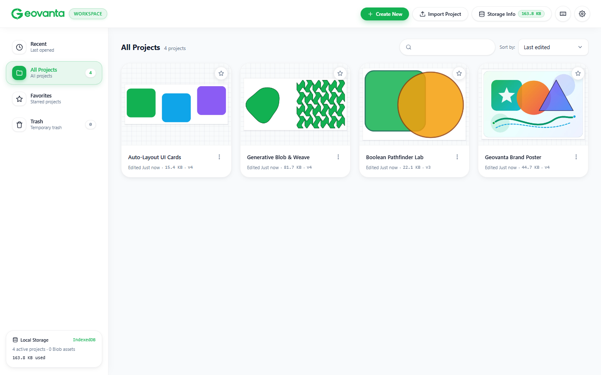
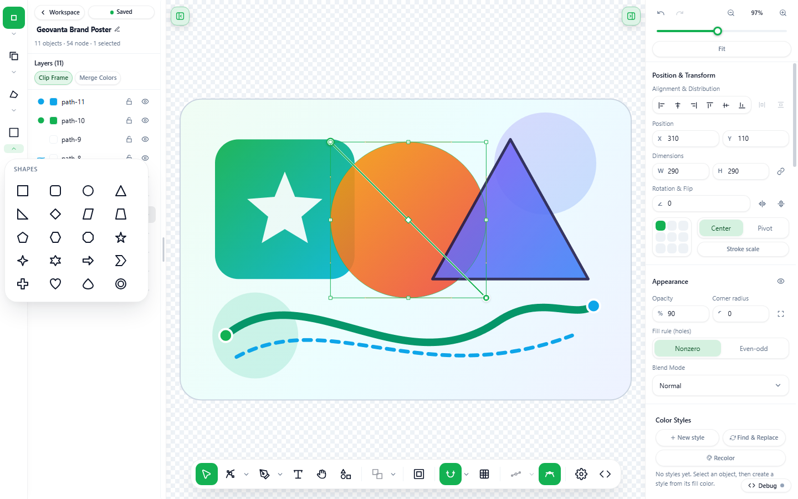
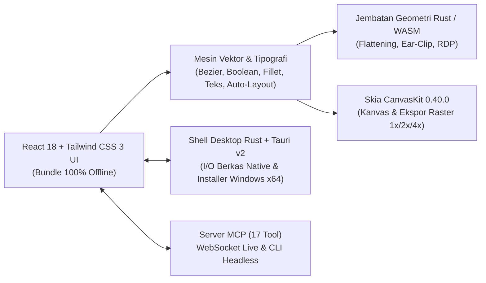

<div align="center">


# Geovanta Vector Editor

**Desain vektor presisi tanpa batas — 100% offline, secepat aplikasi desktop native, dan siap terhubung dengan AI.**

<p>
  <a href="README.id.md"></a>
  <a href="README.md"></a>
  <a href="https://geovanta.netlify.app" target="_blank"></a>
  <a href="https://github.com/zypherianastrid/Geovanta/releases/tag/v1.0.0" target="_blank"></a>
  <a href="CHANGELOG.md"></a>
</p>

<p>
  
  
  
  
  
  
  
  
  
  <a href="https://geovanta.netlify.app" target="_blank"></a>
</p>

<p>
  <a href="https://geovanta.netlify.app" target="_blank">🌐 WebApp</a> •
  <a href="#-mengapa-geovanta">Mengapa Geovanta</a> •
  <a href="#-tur-fitur-visual">Tur Fitur Visual</a> •
  <a href="#-referensi-lengkap-seluruh-fitur">Semua Fitur</a> •
  <a href="#-integrasi-ai--model-context-protocol-mcp">AI & MCP</a> •
  <a href="#%EF%B8%8F-pintasan-papan-ketik">Pintasan</a> •
  <a href="#%EF%B8%8F-arsitektur">Arsitektur</a> •
  <a href="#-instalasi--cara-pakai">Instalasi</a>
</p>

<br />


*Geovanta Vector Editor — Mode Terang lengkap dengan Gradient Canvas Gizmo interaktif, Layer Tree Ter-virtualisasi, dan Inspector presisi*

<br />


*Geovanta Vector Editor — Mode Gelap yang nyaman di mata dengan lokalisasi penuh Bahasa Indonesia & Inggris*

</div>

---

## 🌟 Mengapa Geovanta?

Banyak aplikasi desain vektor modern memaksa pengguna memilih di antara dua keterbatasan: aplikasi berbasis cloud mengunci berkas di balik langganan dan koneksi internet wajib, sementara perangkat lunak desktop lama terasa berat dan terpisah dari alur kerja kode frontend maupun AI modern.

**Geovanta Vector Editor** hadir menjembatani keduanya:

| Pilar Utama | Keunggulan yang Anda Dapatkan |
| :--- | :--- |
| 🔒 **100% Offline & Local-First** | Tanpa ketergantungan CDN eksternal maupun akun cloud wajib. Seluruh proyek, riwayat revisi, font kustom, kurva Bézier, dan aset gambar tersimpan lokal di IndexedDB dengan dukungan arsip cadangan `.geovanta` (ZIP). |
| 🌐 **Aplikasi Desktop + WebApp Instan** | Jalankan sebagai **Aplikasi Desktop Windows 64-Bit** (`.exe` / `.msi` berbasis Rust + Tauri v2) atau buka langsung melalui **[Live WebApp](https://geovanta.netlify.app)** di peramban tanpa instalasi. |
| ⚡ **Kecepatan Skia & Rust/WASM** | Ditenagai mesin WebAssembly Skia CanvasKit 0.40.0, Dynamic Interactive LOD, indeks spasial, cache geometri, serta akselerasi Rust/WASM untuk zoom dan geser kanvas mulus **60+ FPS**. |
| 🎨 **Studio Vektor, Tipografi & UI Lengkap** | Pengeditan node Bézier kubik, fillet per-sudut 3 mode, operasi Boolean Greiner-Hormann, tipografi vektor lengkap dengan embed Google Fonts & konversi teks ke path, gradien ganda Fill/Stroke, 16 blend mode, efek layer (`fx`), Auto-Layout ala Figma, dan editor kode dua arah SVG/JSX/Vue. |
| 🤖 **AI Hibrida via MCP** | Dilengkapi **17 tool resmi Model Context Protocol (MCP)** untuk Antigravity (AGY) dan Google Gemini — bekerja live di kanvas dengan dukungan `Ctrl+Z` Undo/Redo penuh atau berjalan otomatis lewat CLI headless. |
| 🌍 **Pengalaman Dwibahasa Penuh** | Beralih instan antara **Bahasa Indonesia** dan **Bahasa Inggris**, lengkap dengan tema Terang/Gelap/Sistem, deteksi aksen Windows otomatis, dan 20+ palet warna aksen. |

---

## 🎯 Tur Fitur Visual

### 1. Workspace 100% Offline & Galeri Proyek
Kelola seluruh karya vektor secara lokal tanpa ketergantungan server. Saring berdasarkan **Semua Proyek**, **Terbaru**, **Favorit**, dan **Sampah**, cari serta urutkan seketika (*Terakhir Diubah, Tanggal Dibuat, Nama A–Z*), pilih preset artboard (`800×600`, `1080×1080`, `1920×1080`, atau ukuran kustom `32–16.384 px`), pulihkan sesi/revisi otomatis, pantau metrik penyimpanan IndexedDB, dan pindahkan proyek antarperangkat menggunakan arsip `.geovanta`.



---

### 2. Perangkat Menggambar Lengkap & 20+ Bentuk Parametrik
Menggambar bebas atau bangun geometri presisi menggunakan alat **Pilih (`V`)**, **Edit Node (`A`/`N`)**, **Pen (`P`)**, **Pensil**, **Kuas (Brush)**, **Curvature**, **Shape Builder**, **Segmen Garis**, **Busur Parametrik (Arc)**, **Teks (`T`)**, **Frame (`Ctrl+Alt+G`)**, dan **Tangan / Geser (`H`/`Spasi`)** — dipadukan dengan pustaka **20 bentuk parametrik** (*Persegi, Persegi Bulat, Lingkaran/Elips, Segitiga, Segitiga Siku, Belah Ketupat, Jajar Genjang, Trapesium, Segilima, Segienam, Segidelapan, Bintang 4/5/6 Sudut, Panah, Chevron, Plus, Hati, Tetesan, dan Cincin*).



---

### 3. Pengeditan Node, Handle & Kurva Bézier Kubik Presisi
Masuk ke **Mode Edit Node (`A` / `N` / `Enter`)** untuk membentuk setiap titik jangkar dan tangen langsung di kanvas. Dilengkapi alat **Tambah Node**, **Tambah Handle**, **Auto Handle (`B`)**, **Luruskan & Ratakan Sudut Node**, **Penyederhanaan Kurva Topologis (`S` — RDP + Least-Squares Cubic Bézier Fitting)**, **Sakelar Auto-Simplify**, **Fillet Sudut Individual 3 Mode (*Circular / Squircle / Bevel*)**, **16 Aksi Node & Path**, **Compound Path**, **Auto-Refine Geometry**, serta pengaturan **Ukuran Visual Node & Handle (`50%–300%`)**.


---

### 4. Operasi Boolean / Pathfinder & Offset Path
Gabungkan dan potong bentuk kompleks secara presisi menggunakan **Union (`Ctrl+Alt+U`)**, **Subtract (`Ctrl+Alt+S`)**, **Intersect (`Ctrl+Alt+I`)**, **Exclude (`Ctrl+Alt+X`)**, dan **Divide (`Ctrl+Alt+D`)** (ditenagai *clipping poligon Greiner-Hormann* dengan pencocokan ulang kurva Bézier otomatis), ditambah **Outline Stroke (`Ctrl+Alt+O`)**, **Panel Offset Path Interaktif**, dan **Flatten (`Ctrl+E`)**.


---

### 5. Seni Vektor Generatif — Generator Blob, Weave & Busur (Arc)
Buat bentuk organik, pola anyaman rumit, maupun busur lingkaran presisi secara parametrik dalam hitungan detik:
- **Generator Blob**: Atur *Jumlah Titik (`3–48`), Ketidakteraturan (`0–100%`), Kehalusan (`0–100%`), Rotasi (`0–360°`), Ketajaman / Spikiness (`0–100%`), angka Seed*, dan tombol *Acak (Random)*.
- **Generator Weave (Anyaman)**: Pilih *Bentuk Gelombang (`Sine / Triangle / Square`)* dan sesuaikan *Kolom (`2–16`), Baris (`2–16`), Amplitudo (`0–100%`), Ketebalan Pita (`10–100%`), Jarak Celah (`0–100%`), Frekuensi (`1x–4x`), serta Geser Fase (`0–360°`)* secara langsung.
- **Busur Parametrik (Arc)**: Ubah *Radius (`1–500`), Sudut Awal (`0–360°`), dan Sudut Sapuan (`0–360°`)* secara non-destruktif.


---

### 6. Auto-Layout Bergaya Figma, Frame & 10 Mode Smart Snapping Figcraft
Pilih sekumpulan elemen lalu tekan **`Shift + A`** untuk membungkusnya menjadi **Frame Auto-Layout** responsif dengan aliran **Baris (Row)**, **Kolom (Column)**, dan **Grid (`1–10` kolom)**, perataan 9 titik, jarak antar-elemen (*gap*), **Padding Simetris** atau **4 Sisi Independen (`T/R/B/L`)**, latar & radius sudut frame, **Clip Frame**, serta tombol **Pas ke Artboard**. Sejajarkan objek dengan presisi lewat **10 Mode Matriks Smart Snapping Figcraft** lengkap dengan garis pandu jarak (*redlines*).


---

### 7. Gradien Ganda Fill/Stroke, Color Styles, Recolor, Blend Mode & Efek (`fx`)
Warnai objek dengan mode **Solid**, **Linear**, **Radial**, dan **Angular (Conic)** secara independen pada **Fill maupun Stroke** — lengkap dengan **Gradient Canvas Gizmo** interaktif di kanvas, pengatur posisi & opasitas multi-stop, **Color Styles** dokumen yang saling tertaut, **Salin/Tempel Warna & Gradien**, **Recolor Engine**, **Cari & Ganti Warna (Find & Replace)**, **Warna Seleksi & Pilih Serupa (`Fill / Stroke / Tipe`)**, **Pipet Layar**, aturan isi (*Nonzero / Even-odd*), **16 Blend Mode**, serta efek **Drop Shadow / Layer Blur / Background Blur**.


---

### 8. Peramban Ikon Vektor Iconify Bawaan (16.520+ Ikon)
Cari ribuan ikon lintas kategori dan koleksi open-source (termasuk Material Symbols, Lucide, MDI, dan lainnya) langsung di dalam Geovanta, lalu sisipkan sebagai path vektor yang dapat diedit sepenuhnya di kanvas.


---

### 9. Inspector Kode SVG Live Dua Arah & Ekspor Multi-Framework
Dirancang untuk desainer *sekaligus* developer. Tekan **`Ctrl + Alt + C`** untuk membuka **SVG Code Inspector & Live Editor** dengan sinkronisasi dua arah secara real-time, tombol **Rapikan (Prettify) / Perkecil (Minify) / Salin / Unduh**, serta tab konversi instan ke:
- **SVG XML (Live)**
- **Web Minified**
- **React JSX**
- **Vue SFC**
- **CSS Data URI**


---

### 10. Ekspor Multi-Format (`SVG`, `PNG`, `JPG`, `WEBP`, `AI`, `EPS`), Impor & Backup Portabel
Ekspor **Artboard**, **Semua Objek**, atau **Seleksi Saat Ini** ke format **SVG**, **PNG**, **JPG**, **WebP** (rasterisasi CPU Skia CanvasKit pada skala **`1x`**, **`2x (HD)`**, atau **`4x (Ultra)`**), **Adobe Illustrator (`.AI`)**, serta **Encapsulated PostScript (`.EPS`)**. Salin langsung ke clipboard atau unduh sebagai berkas, atur latar kanvas **Transparan / Solid**, pilih **Penghalusan Tepi (Antialiasing / Kurangi Celah)** vs. **Pratinjau Piksel 1×1**, impor **12+ format berkas vektor/raster/font**, atau ekspor **Arsip Cadangan Proyek `.geovanta`**.


---

### 11. Personalisasi, Telemetri Performa, Tema & Antarmuka Dwibahasa Penuh
Sesuaikan ruang kerja dengan preferensi Anda: beralih mulus antara tema **Terang**, **Gelap**, dan **Sistem**, ganti bahasa antarmuka antara **Bahasa Indonesia** dan **Bahasa Inggris**, pilih dari **20+ palet warna aksen** (*Hijau Geovanta, Deteksi Otomatis Aksen Sistem Windows, Biru Figma, Indigo, Violet, Emerald, Amber, Rose, Slate*, maupun kode hex/pipet kustom), serta jalankan **Benchmark Suite & Telemetri Cache Geometri** bawaan.


---

## 📋 Referensi Lengkap Seluruh Fitur

> Untuk riwayat rilis kronologis sejak versi awal, lihat **[CHANGELOG.md](CHANGELOG.md)**.

### 🔤 Tipografi & Mesin Teks Vektor
| Fitur Tipografi | Detail Kemampuan |
| :--- | :--- |
| **Edit Langsung di Kanvas & Inspector Live** | Klik dua kali teks atau tekan **Edit di kanvas** untuk mengetik langsung dengan kursor, atau ketik melalui **Inspector Tipografi** dengan pratinjau kanvas real-time dan perekaman Undo satu langkah (`Ctrl+Enter` / lepas fokus; `Escape` untuk batal). |
| **Font Bawaan & Impor Font Lokal** | Dibundel offline dengan keluarga font **IBM Plex Sans** (*Regular, Italic, Bold, Bold Italic*). Mendukung impor berkas font **`.TTF` dan `.OTF`** lokal langsung ke penyimpanan aset proyek. |
| **Katalog & Auto-Embed Google Fonts** | Cari dan pratinjau tampilan huruf dari katalog **Google Fonts** langsung di menu dropdown; memilih Google Font akan mengunduh dan menyematkan (*embed*) binari font ke dalam proyek agar tetap 100% siap offline. |
| **Deteksi & Pemulihan Font Hilang** | Mendeteksi otomatis bila proyek memakai font yang belum terpasang, menjaga nama keluarga font asli, dan menyediakan tombol satu klik **Impor `.TTF/.OTF`** atau **Pakai IBM Plex Sans**. |
| **Ketebalan, Gaya & Ukuran Huruf** | Pilihan **Regular**, **Medium (`500`)**, **SemiBold (`600`)**, dan **Bold**, tombol cepat **Tebal (`B`)** serta **Miring (`I`)**, dan ukuran huruf dari **`1 px` hingga `10.000 px`**. |
| **Metrik Jarak 3 Kolom** | Kontrol presisi ala Figma: **Tinggi Baris / Line Height (`0.5–5.0`)**, **Jarak Huruf / Letter Spacing (`-200` s/d `1.000 px`)**, dan **Jarak Paragraf / Paragraph Spacing (`0–1.000 px`)**. |
| **3 Mode Ukuran Kotak Teks** | **Lebar Auto (`Auto W`)** (teks satu baris yang melebar otomatis), **Tinggi Auto (`Auto H`)** (lebar tetap dengan pembungkusan baris otomatis ke bawah), dan **Tetap (`Fixed`)** (kotak teks ukuran `W × H` tetap). |
| **Perataan Horizontal & Vertikal** | Horizontal: **Rata Kiri**, **Rata Tengah**, **Rata Kanan**, **Rata Kiri-Kanan (Justify)**. Vertikal: **Rata Atas**, **Rata Tengah Vertikal**, **Rata Bawah**. |
| **Kapitalisasi (Case) & Dekorasi Teks** | Kapitalisasi: **Sesuai Ketikan (`—`)**, **HURUF BESAR (`AG`)**, **huruf kecil (`ag`)**, **Awalan Kapital (`Ag`)**. Dekorasi: **Tanpa Garis (`—`)**, **Garis Bawah (`U`)**, **Coret Tengah (`S`)**. |
| **Ubah Teks ke Path (`Outline`)** | Tombol **Ubah ke Path (`Ke Path` / `Outline`)** berbasis `opentype.js` mengubah kontur huruf menjadi path vektor Bézier kubik yang dapat diedit titik node-nya (juga dijalankan otomatis saat ekspor `.AI` dan `.EPS`). |

### 📤 Opsi Ekspor, Impor & Interoperabilitas Kode
| Fitur Ekspor / Impor | Opsi yang Didukung |
| :--- | :--- |
| **6 Format Ekspor** | **`.SVG`** (XML vektor standar), **`.PNG`** (mendukung transparansi alfa), **`.JPG`**, **`.WEBP`**, **`.AI`** (dokumen vektor kompatibel Adobe Illustrator), dan **`.EPS`** (Encapsulated PostScript siap cetak dengan konversi teks-ke-path otomatis). |
| **Skala Resolusi Raster** | Pilihan resolusi ekspor PNG / JPG / WebP: **`1x`**, **`2x (HD)`**, dan **`4x (Ultra)`** menggunakan rasterizer CPU Skia CanvasKit. |
| **3 Cakupan Area Ekspor** | **Artboard (`board`)** (sesuai batas kanvas artboard), **Semua Objek (`content`)** (kotak pembatas rapat seluruh objek terlihat), atau **Seleksi (`sel`)** (hanya mengekspor objek yang sedang dipilih). |
| **Salin ke Clipboard vs. Unduh Berkas** | Tombol **Salin** menyalin kode `.SVG` / `.AI` / `.EPS` atau gambar `.PNG` beresolusi tinggi langsung ke clipboard sistem; tombol **Unduh** menyimpan berkas ke penyimpanan lokal. |
| **Inspector Kode SVG Live (`Ctrl+Alt+C`)** | Edit kode XML SVG secara live dengan pembaruan kanvas instan, fitur **Prettify**, **Minify**, **Copy**, **Download**, dan 5 tab output: **SVG XML (Live)**, **Web Minified**, **React JSX**, **Vue SFC**, serta **CSS Data URI**. |
| **Impor Multi-Format & Tempel Clipboard** | Impor berkas **`.SVG`, `.AI`, `.EPS`, `.PS`, `.PDF`, `.PNG`, `.JPG`, `.JPEG`, `.WEBP`, `.GIF`, `.TTF`, `.OTF`**, atau tempel objek vektor dan gambar langsung dari clipboard (`Ctrl+V`). |
| **Latar Kanvas & Penghalusan Tepi** | Pilih latar kanvas **Transparan** atau **Warna Solid**; aktifkan **Penghalusan Tepi (Antialiasing / Kurangi Celah)** atau mode tajam **Pratinjau Piksel 1×1**. |
| **Backup Proyek Portabel (`.geovanta`)** | Ekspor dan impor seluruh proyek beserta riwayat revisi, font tersemat, dan aset gambar dalam satu arsip ZIP **`.geovanta`**. |

### 🎨 Fill, Stroke, Gradien, Sistem Warna & Efek Layer (`fx`)
| Subsistem | Kemampuan Lengkap |
| :--- | :--- |
| **Slot Warna & Gradien Ganda (Fill & Stroke)** | Terapkan **Warna Solid**, **Gradien Linear**, **Gradien Radial**, **Gradien Angular (Conic)**, atau **Tanpa Warna** secara terpisah pada **Fill** maupun **Stroke**, lengkap dengan **Gradient Gizmo** interaktif di kanvas. |
| **Pengaturan Garis (Stroke) Mendalam** | **Tebal Garis (`0–10.000 px`)**, **Skalakan Garis bersama Objek**, **Posisi Garis** (*Tengah / Dalam / Luar*), **Urutan Gambar** (*Fill Depan / Stroke Depan*), **Ujung Garis / Cap** (*Round / Butt / Square*), **Sudut Garis / Join** (*Round / Miter dengan Batas Miter `1x–100x` / Bevel*), **Preset Garis Putus** (*Solid / Dashed / Dotted / Dash-Dot / Custom Dash Array*), dan **Dash Offset (`-100` s/d `+100 px`)**. |
| **Color Styles & Clipboard Warna** | Buat **Color Styles** dokumen yang saling tertaut, ubah warna style untuk memperbarui seluruh objek terkait secara serentak, ambil warna layar dengan **Pipet Layar**, pilih **Warna Terbaru**, serta **Salin / Tempel Warna Solid maupun Gradien** antar-objek. |
| **Warna Seleksi, Recolor & Cari/Ganti Warna** | Pantau daftar warna pada objek terpilih, gunakan tombol **Pilih Serupa (`Fill / Stroke / Tipe`)**, jalankan **Cari & Ganti Warna (Find & Replace)**, atau ubah harmoni palet lewat **Recolor Artwork**. |
| **16 Blend Mode** | *Normal*, *Darken*, *Multiply*, *Color Burn*, *Lighten*, *Screen*, *Color Dodge*, *Overlay*, *Soft Light*, *Hard Light*, *Difference*, *Exclusion*, *Hue*, *Saturation*, *Color*, dan *Luminosity*. |
| **Efek Layer Bertumpuk (`fx`)** | Efek non-destruktif **Drop Shadow** (`dx`, `dy`, `blur`, `warna`, `opasitas`), **Layer Blur** (Gaussian blur `0–100 px`), dan **Background Blur** (blur latar `0–100 px`) dengan sakelar tampil/sembunyi dan hapus per efek. |

### 📐 Fillet Sudut, Aksi Node, Smart Snapping & Hierarki Layer
| Subsistem | Kemampuan Lengkap |
| :--- | :--- |
| **Mesin Fillet Sudut 3 Mode** | Pembulatan sudut seragam maupun per titik sudut (`#1`, `#2`, dst.) dalam mode **Circular**, **Squircle (Bézier Kubik)**, atau **Bevel (Chamfer)**, dilengkapi filter cepat **Semua**, **Ganjil**, **Genap**, dan **Tajamkan (`0`)**. |
| **16 Aksi Node & Path** | *Hapus Node, Halus (Smooth), Sudut Tajam (Corner), Simetris, Auto-Smooth, Putus Handle (Free Curve), Gabung 2 Ujung Node (Join), Potong Path (Split), Tutup Path, Buka Path, Balik Arah Path (Reverse), Luruskan (Straighten), Sederhanakan (`S`), Ubah ke Kurva, Outline Stroke (`Ctrl+Alt+O`), dan Offset Path*. |
| **10 Mode Matriks Smart Snapping** | *Smart Guides (Kotak & Pusat), Jarak Sama Rata (Equal Spacing), Tepi & Pusat Artboard, Titik Node & Handle, Sejajar Sumbu Node (X/Y), Titik Tengah Segmen (Midpoint), Kontur / Tepi Path, Siku (`90°`) & Perpanjangan Garis, Garis Grid Adaptif, serta Bulatkan ke Piksel (`1 px`)* dengan preset **Semua / Minimal / Bawaan**. |
| **Pin Grid 9 Titik & Perataan 8 Arah** | Transformasi `X, Y, W, H, ∠` berbasis titik **Pusat** atau **9 Titik Jangkar Pin Grid**; **Kunci Rasio Aspek**; **Balik H/V (`Shift+H/V`)**; **Ratakan Kiri / Tengah / Kanan / Atas / Tengah Vertikal / Bawah** (`Alt+W/A/S/D/H/V`) & **Sebar Horizontal / Vertikal**. |
| **Layer Tree Ter-virtualisasi & Bucket Warna** | Hierarki layer 60 FPS dengan geser-lepas (*drag-and-drop*) ke dalam Group/Frame, tombol keluarkan anak (*eject*), ganti nama inline, kunci/sembunyikan, lencana jumlah node, dan mode **Kelompokkan Warna Sama**. |

---

## 🤖 Integrasi AI & Model Context Protocol (MCP)

Geovanta menyertakan server resmi **Model Context Protocol (MCP)** (`scripts/mcp-server/`) untuk **Antigravity (AGY)** dan **Google Gemini** (termasuk konektor Streamable HTTP + OAuth 2.1 untuk Gemini Web).


### Arsitektur Hibrida: Mode Live vs. Mode Headless
1. **Mode Live (Sinkronisasi Kanvas Real-Time)**: Menghubungkan antarmuka Geovanta yang sedang aktif ke server MCP lokal melalui WebSocket (port bawaan `38291` / URL tunnel kustom). Setiap bentuk, teks, pengeditan kurva, atau perubahan warna dari AI tercatat rapi di riwayat transaksi Geovanta — batalkan kapan saja dengan `Ctrl + Z`.
2. **Mode Headless (Mesin CLI Mandiri)**: Bahkan saat aplikasi GUI ditutup, agen AI tetap dapat mengurai SVG, membuat geometri parametrik, menyederhanakan kurva, menjalankan operasi Boolean, membulatkan sudut, mengganti palet warna, dan menghasilkan SVG bersih secara otonom lewat `scripts/mcp-server/engineAdapter.js`.

### 17 Tool Resmi MCP

| Kategori | Daftar Tool |
| :--- | :--- |
| **Workspace & Status** | `geovanta_status`, `geovanta_workspace_manage`, `geovanta_artboard_and_view`, `geovanta_layer_manage` |
| **Pembuatan Vektor & Teks** | `geovanta_shape_create` *(rect, circle, star, polygon, spiral, blob, weave)*, `geovanta_text_create`, `geovanta_iconify_insert` |
| **Geometri & Warna** | `geovanta_curve_simplify`, `geovanta_boolean_operation`, `geovanta_corner_fillet`, `geovanta_recolor` |
| **SVG & Kanvas Live** | `geovanta_svg_parse`, `geovanta_svg_serialize`, `geovanta_live_get_canvas`, `geovanta_live_mutate_canvas`, `geovanta_live_select_objects`, `geovanta_live_export` |

---

## ⌨️ Pintasan Papan Ketik

Tekan **`?`** kapan saja di kanvas atau buka **Pengaturan → Pintasan** untuk melihat panduan lengkap di dalam aplikasi:


| Kategori | Pintasan | Aksi |
| :--- | :--- | :--- |
| **Berkas & Kode** | `Ctrl+S` / `Ctrl+C` / `Ctrl+V` / `Ctrl+Alt+C` | Unduh SVG / Salin Seleksi / Tempel Objek atau Gambar / Inspector Kode SVG Live |
| **Alat** | `V` / `A` atau `N` / `P` / `S` / `B` / `H` atau `Spasi` | Pilih / Edit Node / Pen / Simplify / Auto Handle / Tangan (Geser Kanvas) |
| **Objek** | `Ctrl+Z` / `Ctrl+Y` / `Ctrl+A` / `Ctrl+D` / `Del` / `Esc` | Undo / Redo / Pilih Semua / Duplikat / Hapus Seleksi / Batalkan Seleksi |
| **Group & Frame** | `Ctrl+G` / `Ctrl+Shift+G` / `Ctrl+Alt+G` / `Shift+A` / `Ctrl+E` | Group / Ungroup / Buat Frame / Frame Auto-Layout / Flatten |
| **Boolean & Path** | `Ctrl+Alt+U` / `S` / `I` / `X` / `D` / `O` / `Enter` | Union / Subtract / Intersect / Exclude / Divide / Outline Stroke / Masuk Edit Node |
| **Susunan & Rata** | `]` / `[` / `Ctrl+]` / `Ctrl+[` / `Shift+H` / `Shift+V` / `Alt+W,A,S,D,H,V` | Naik/Turun 1 Layer / Paling Depan/Belakang / Flip H/V / Ratakan Atas, Kiri, Bawah, Kanan, Tengah |
| **Layer & Opasitas** | `Ctrl+Shift+H` / `Ctrl+Shift+L` / `R` atau `Shift+R` / `0…9` | Sembunyikan/Tampilkan / Kunci/Buka Layer / Resize atau Rotate Interaktif / Opasitas `10%–100%` |
| **Tampilan & Bantuan** | `0` / `2` / `Shift+1` / `+` `-` / `Panah` / `,` / `?` / `Ctrl+Shift+D` | Pas Kanvas / Zoom Seleksi / Zoom Pas / Perbesar-Perkecil / Geser (`Shift` = `10 px`) / Pengaturan / Pintasan / Mode Debug |

---

## 🏗️ Arsitektur



### Struktur Direktori Utama
- `src/` — Kode sumber aplikasi React 18 + TypeScript/TSX (`engine/`, `renderer/`, `components/`, `workspace/`, `constants/`, `utils/`, `bridge/`, `vendor/`, `assets/fonts/`, `data/`)
- `src-tauri/` — Backend Rust & konfigurasi Tauri v2 untuk installer Windows 64-bit (**NSIS `.exe`** & **WiX `.msi`**)
- `rust/` — Modul akselerasi WebAssembly berbasis Rust
- `scripts/mcp-server/` — Server resmi Model Context Protocol (`index.js`, `tools.js`, `engineAdapter.js`)
- `web/` — Bundle web siap pakai 100% offline (`web/index.html` + aset WebAssembly CanvasKit lokal)
- `tests/` — Pengujian unit Node & pengujian E2E/performa Playwright
- `CHANGELOG.md` — Catatan rilis lengkap dan katalog seluruh fitur mulai dari `v1.0.0`

---

## 🚀 Instalasi & Cara Pakai

### Opsi 1: 🌐 Gunakan WebApp (Tanpa Instalasi)
Buka Geovanta langsung di peramban modern (Chrome, Edge, Firefox) tanpa perlu mengunduh atau memasang apa pun:
- **Live WebApp**: **[https://geovanta.netlify.app](https://geovanta.netlify.app)**

### Opsi 2: 🪟 Pasang Aplikasi Desktop — Windows 64-Bit (Rilis `v1.0.0`)
Unduh installer resmi Windows 64-bit langsung dari **[GitHub Releases (v1.0.0)](https://github.com/zypherianastrid/Geovanta/releases/tag/v1.0.0)**:
1. Unduh [`Geovanta-Vector-Editor_1.0.0_x64-setup.exe`](https://github.com/zypherianastrid/Geovanta/releases/download/v1.0.0/Geovanta-Vector-Editor_1.0.0_x64-setup.exe).
2. Jalankan berkas `.exe` dan ikuti panduan instalasi.
3. Buka **Geovanta Vector Editor** dari Start Menu atau pintasan Desktop.

### Opsi 3: 📦 Jalankan Bundle Offline Secara Lokal (Tanpa Build)
Buka atau jalankan `web/index.html` melalui peramban modern (Chrome / Edge). Seluruh bundle JavaScript, font, dan runtime WebAssembly Skia CanvasKit sudah tersedia secara lokal tanpa koneksi internet.

### Opsi 4: 🛠️ Pengembangan & Build Ulang dari Sumber
```sh
# 1. Pasang dependensi
npm ci

# 2. Jalankan unit test & pengecekan sintaks TypeScript
npm test
npm run typecheck

# 3. Bangun ulang bundle web 100% offline (memperbarui dist/ & web/)
npm run build:web
```

#### Build Installer Desktop Windows 64-Bit (`.exe` & `.msi`)
Membutuhkan **Node.js 20+**, **Rust MSVC** (`x86_64-pc-windows-msvc`), **Visual Studio Build Tools (Desktop development with C++)**, dan **Tauri CLI v2**:
```bat
build-windows-64bit.bat
```
Hasil installer Windows 64-bit akan tersedia di:
- **NSIS Installer (`.exe`)**: `src-tauri\target\x86_64-pc-windows-msvc\release\bundle\nsis\Geovanta Vector Editor_1.1.0_x64-setup.exe`
- **WiX MSI Installer (`.msi`)**: `src-tauri\target\x86_64-pc-windows-msvc\release\bundle\msi\Geovanta Vector Editor_1.1.0_x64_en-US.msi`

*(Build otomatis di GitHub Actions juga sudah disiapkan pada `.github/workflows/build-windows-x64.yml`.)*

---

## 👥 Kontributor

<table>
  <tr>
    <td align="center">
      <a href="https://github.com/zypherianastrid">
        <br />
        <sub><b>zyphee (@zypherianastrid)</b></sub>
      </a><br />
      <sub>Pembuat, Arsitek Utama & Pengembang</sub>
    </td>
  </tr>
</table>

---

<div align="center">
  <sub>Dibangun dengan presisi oleh <strong>Geovanta</strong> (<a href="https://github.com/zypherianastrid">@zypherianastrid</a>) • <a href="CHANGELOG.md">Changelog</a> • Baca dalam <a href="README.md">Bahasa Inggris 🇬🇧</a></sub>
</div>
