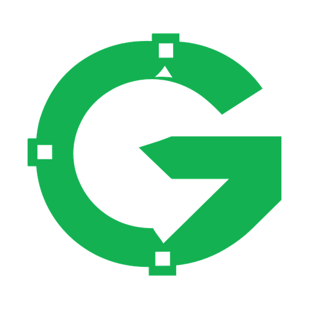
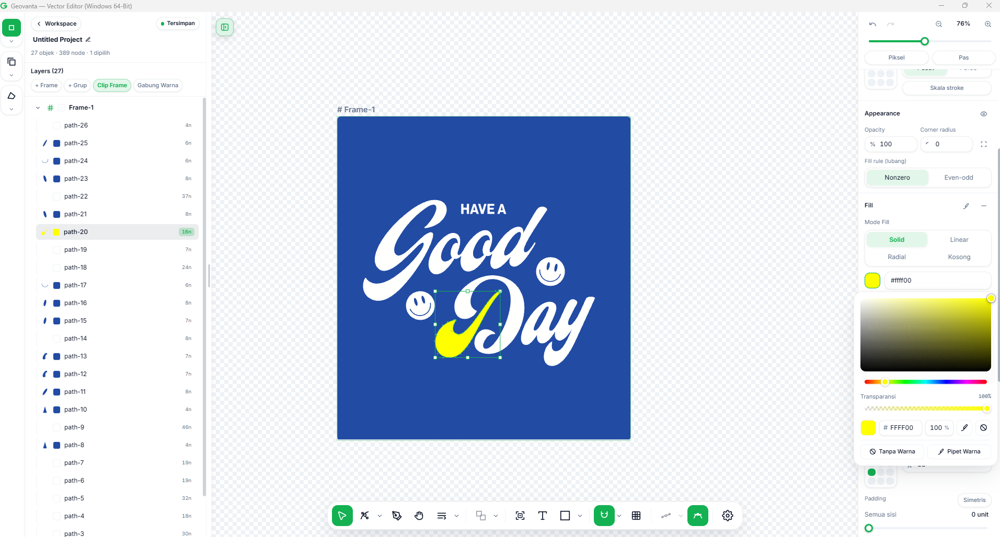
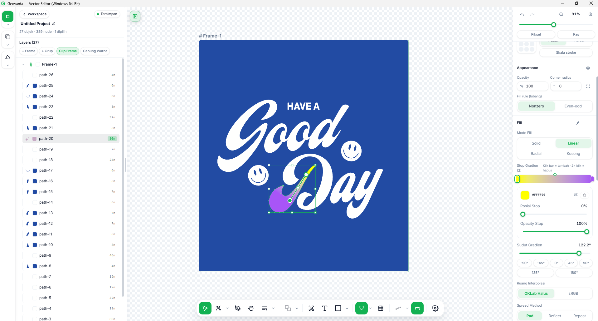
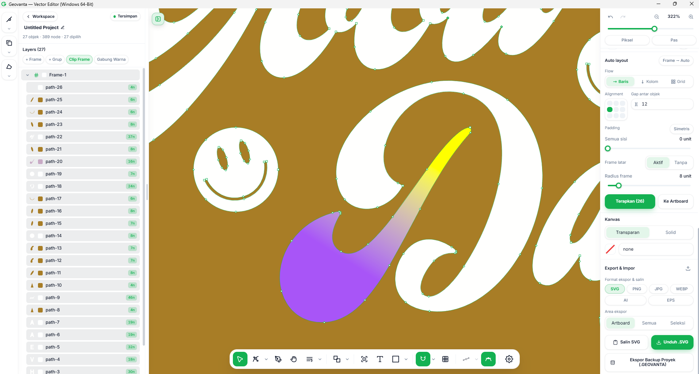
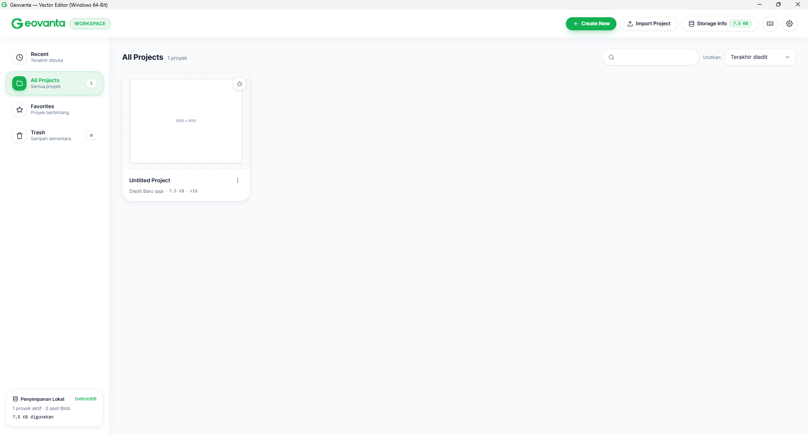
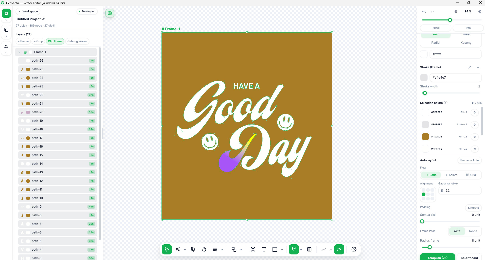
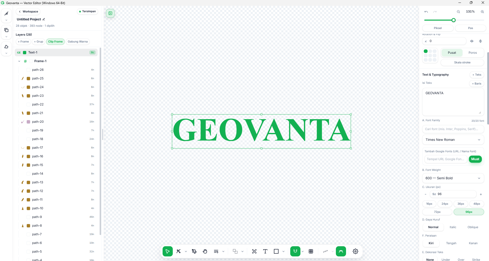
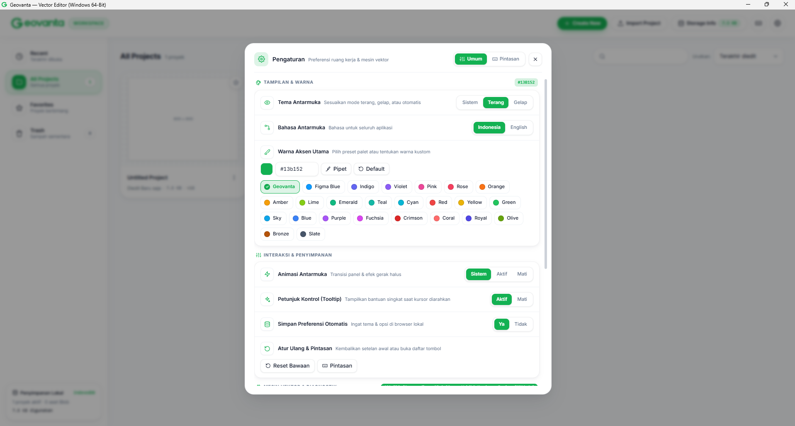
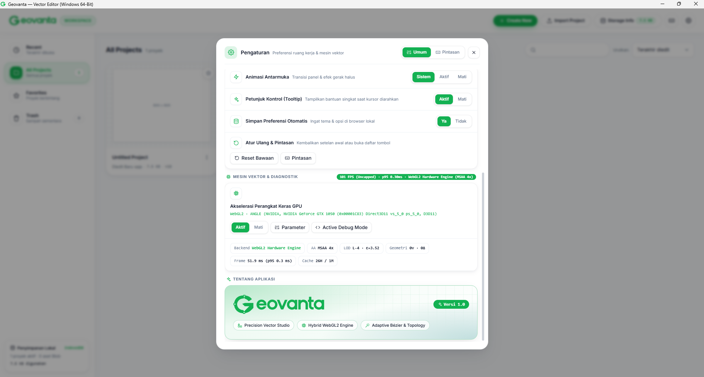

<p align="center">🌐 <a href="README.md">English</a> · <b>Bahasa Indonesia</b></p>

<p align="center">
  
</p>

<h1 align="center">Geovanta Vector Studio</h1>

<p align="center">
  <b>Editor vektor desktop untuk Windows 64-bit — cepat, presisi, dan 100% offline.</b><br>
  Buat logo, ikon, ilustrasi, dan artwork vektor tanpa internet, tanpa langganan, tanpa loading CDN.
</p>

<p align="center">
  
  
  
  
  
</p>

<p align="center">
  <a href="https://geovanta.netlify.app/"><b>🌐 Coba Geovanta langsung — tanpa instalasi</b></a>
</p>

<p align="center">
  
  <br><em>Mengedit artwork di Geovanta — layer, warna, dan kanvas dalam satu layar.</em>
</p>

---

## ✨ Kenapa Geovanta?

| | |
|---|---|
| 🖥️ **Desktop asli, bukan web** | Rust + Tauri v2. Ringan, native, dan file kamu tetap di komputermu. |
| 🔌 **100% offline** | Tanpa CDN, tanpa akun, tanpa server. React & Tailwind sudah dibundel lokal. |
| 🎯 **Presisi ala Figma** | Snapping cerdas, equal spacing, dan panduan sejajar yang terasa natural. |
| ✂️ **Pathfinder lengkap** | Boolean, Outline Stroke, dan Offset Path — fitur yang biasanya hanya ada di editor berbayar. |
| 🌐 **Indonesia & English** | Seluruh antarmuka dan 303 tooltip tersedia dalam dua bahasa. |
| ⚡ **Akselerasi GPU** | Mesin vektor WebGL2 dengan MSAA 4x — kanvas tetap mulus saat di-zoom. |

## 🚀 Fitur Utama

### 🎨 Menggambar & Mengedit Vektor
- **Node editing Bézier** — edit titik, handle, dan kurva dengan kontrol penuh, sampai zoom 322%
- **Shape, teks, dan gradien** — bentuk siap pakai, teks dengan Google Fonts, dan gradient gizmo di kanvas (Linear / Radial, OKLab & sRGB)
- **Frame & Auto Layout** — susun komponen seperti di Figma: Baris / Kolom / Grid, alignment, gap, dan padding
- **Simplify, fillet, dan straighten** — rapikan path berantakan jadi bersih dalam satu klik

<p align="center">
  
  
  <br><em>Gradien linear dengan gizmo di kanvas, dan node Bézier yang tetap tajam saat di-zoom 322%.</em>
</p>

### ✂️ Boolean / Pathfinder
Gabung, potong, dan iris bentuk sesuka hati — langsung dari floating bar, menu konteks, atau shortcut:

| Operasi | Shortcut | Hasil |
|---|---|---|
| **Union** | `Ctrl+Alt+U` | Gabung 2+ bentuk jadi satu |
| **Subtract** | `Ctrl+Alt+S` | Potong bentuk atas dari bentuk bawah |
| **Intersect** | `Ctrl+Alt+I` | Ambil irisan kedua bentuk |
| **Exclude** | `Ctrl+Alt+X` | Buang irisan, sisakan sisanya |
| **Outline Stroke** | `Ctrl+Alt+O` | Ubah stroke jadi bentuk berisi |
| **Offset Path** | menu konteks | Perbesar / perkecil path −100…+100 pt, join Miter / Bevel / Round, pratinjau langsung |

### 🧲 Snapping ala Figcraft
- Snap 5 px yang terasa pas — tidak terlalu agresif, tidak terlalu longgar
- **Equal spacing** antar objek terdeteksi otomatis
- Tahan `Ctrl` / `Cmd` untuk mematikan snap sementara saat butuh kebebasan

### 🗂️ Workspace & Layer
- Manajemen proyek dengan thumbnail otomatis, favorit, dan trash
- Panel layer yang dioptimalkan — scroll tetap mulus di proyek besar (27 objek, 389 node pada contoh di bawah)
- Penyimpanan lokal (IndexedDB) dan pemulihan crash, tanpa cloud

<p align="center">
  
  
  <br><em>Workspace dengan kartu proyek, dan Frame dengan Auto Layout + Selection Colors.</em>
</p>

### 🔤 Teks & Tipografi
- Font family, weight, ukuran, gaya (Normal / Italic / Oblique), dan dekorasi teks
- Tambah Google Fonts lewat URL, langsung dari panel inspector

<p align="center">
  
  <br><em>Teks GEOVANTA — Times New Roman, 96 px, Semi Bold.</em>
</p>

### 🎛️ Pengaturan yang Bisa Diutak-atik
- Tema Terang / Gelap / Sistem, bahasa Indonesia / English
- **25 warna aksen** — dari Geovanta `#13b152` sampai Figma Blue, Indigo, Violet, dan Slate — plus pipet warna kustom
- Animasi antarmuka, tooltip, dan simpan preferensi otomatis

<p align="center">
  
  
  <br><em>Pengaturan tampilan & warna aksen, serta mesin vektor GPU dan halaman Tentang — Versi 1.0.</em>
</p>

### 📁 Impor & Ekspor
- Ekspor **SVG, PNG, JPG, WEBP, AI, EPS** — per Artboard, Semua, atau Seleksi
- Salin SVG langsung, dan ekspor backup proyek (`.GEOVANTA`)

## 📥 Instalasi

### Opsi 1 — Installer Windows (paling mudah)
1. Build installer di PC Windows 64-bit dengan Rust terinstal, lalu jalankan:
   ```bat
   build-windows-64bit.bat
   ```
2. Hasilnya: installer **NSIS (`.exe`)** dan **WiX MSI (`.msi`)** 64-bit di `src-tauri/target/x86_64-pc-windows-msvc/release/bundle/`.

### Opsi 2 — GitHub Actions
Workflow `.github/workflows/build-windows-x64.yml` membangun `.exe` dan `.msi` otomatis di runner `windows-latest`.

## 🛠️ Untuk Developer

```bash
npm install --no-save esbuild   # sekali saja
npm run build:web               # kompilasi ulang bundle web
```

> `index.html` memuat `dist/assets/geovanta.bundle.js`, bukan `src/*.jsx` langsung — jadi setiap selesai mengedit `src/`, bundle harus dikompilasi ulang.

**Stack:** Rust + Tauri v2 · React 18.3.1 · Tailwind CSS 3.4.17 · esbuild — semuanya offline, tanpa CDN dan tanpa CSS native.

<details>
<summary><b>Struktur proyek</b></summary>

- `src/engine/` — mesin vektor: parser SVG, Bézier, snapping, Boolean, offset, gradien
- `src/renderer/` — renderer kanvas, flattener kubik adaptif, dan triangulasi
- `src/components/editor/` — VectorEditor, floating toolbar, inspector, panel layer
- `src/workspace/` — proyek, aset, thumbnail, dan penyimpanan lokal
- `src-tauri/` — backend Rust + konfigurasi installer Windows 64-bit
- `assets/screenshots/` — screenshot untuk README ini

</details>

## 📄 Lisensi

Geovanta Vector Studio dilisensikan di bawah **Lisensi MIT** — Anda bebas menggunakan, menyalin, mengubah, menggabungkan, menerbitkan, mendistribusikan, mensublisensikan, dan menjual perangkat lunak ini, selama pemberitahuan hak cipta dan pemberitahuan izin ini disertakan dalam semua salinan. Teks lisensi lengkap ada di file [LICENSE](LICENSE):

```
MIT License

Copyright (c) 2026 Geovanta Studio

Permission is hereby granted, free of charge, to any person obtaining a copy
of this software and associated documentation files (the "Software"), to deal
in the Software without restriction, including without limitation the rights
to use, copy, modify, merge, publish, distribute, sublicense, and/or sell
copies of the Software, and to permit persons to whom the Software is
furnished to do so, subject to the following conditions:

The above copyright notice and this permission notice shall be included in all
copies or substantial portions of the Software.

THE SOFTWARE IS PROVIDED "AS IS", WITHOUT WARRANTY OF ANY KIND, EXPRESS OR
IMPLIED, INCLUDING BUT NOT LIMITED TO THE WARRANTIES OF MERCHANTABILITY,
FITNESS FOR A PARTICULAR PURPOSE AND NONINFRINGEMENT. IN NO EVENT SHALL THE
AUTHORS OR COPYRIGHT HOLDERS BE LIABLE FOR ANY CLAIM, DAMAGES OR OTHER
LIABILITY, WHETHER IN AN ACTION OF CONTRACT, TORT OR OTHERWISE, ARISING FROM,
OUT OF OR IN CONNECTION WITH THE SOFTWARE OR THE USE OR OTHER DEALINGS IN THE
SOFTWARE.
```

---

<p align="center">
  <b>Geovanta Vector Studio v1.0</b> — Precision Vector Studio · Hybrid WebGL2 Engine · Adaptive Bézier &amp; Topology
</p>
