<div align="center">


# Geovanta Vector Editor

**Desain vektor presisi tanpa batas — 100% offline, secepat aplikasi desktop native, dan siap terhubung dengan AI.**

<p>
  <a href="README.id.md"></a>
  <a href="README.md"></a>
  <a href="https://geovanta.netlify.app" target="_blank"></a>
  <a href="https://github.com/zypherianastrid/Geovanta/releases/tag/v1.0.0" target="_blank"></a>
</p>

<p>
  
  
  
  
  
  
  
  
  
  <a href="https://geovanta.netlify.app" target="_blank"></a>
</p>

<p>
  <a href="https://geovanta.netlify.app" target="_blank">🌐 WebApp</a> •
  <a href="#-mengapa-geovanta">Mengapa Geovanta</a> •
  <a href="#-tur-fitur-visual">Tur Fitur Visual</a> •
  <a href="#-integrasi-ai--model-context-protocol-mcp">AI & MCP</a> •
  <a href="#%EF%B8%8F-pintasan-papan-ketik">Pintasan</a> •
  <a href="#%EF%B8%8F-arsitektur">Arsitektur</a> •
  <a href="#-instalasi--cara-pakai">Instalasi</a>
</p>

<br />

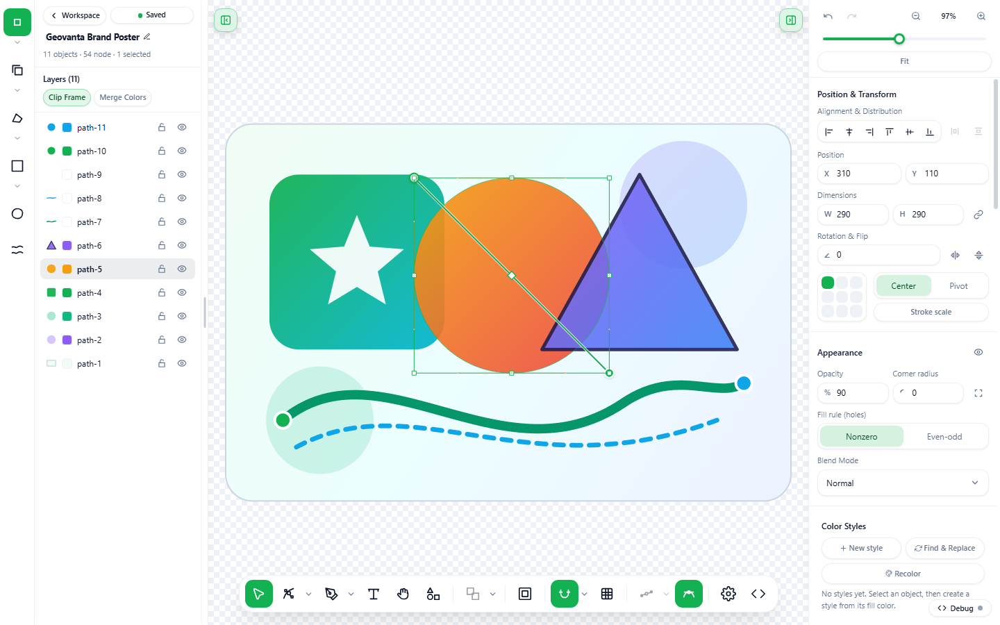

*Geovanta Vector Editor — Mode Terang lengkap dengan Gradient Canvas Gizmo interaktif, Layer Tree, dan Inspector presisi*

<br />

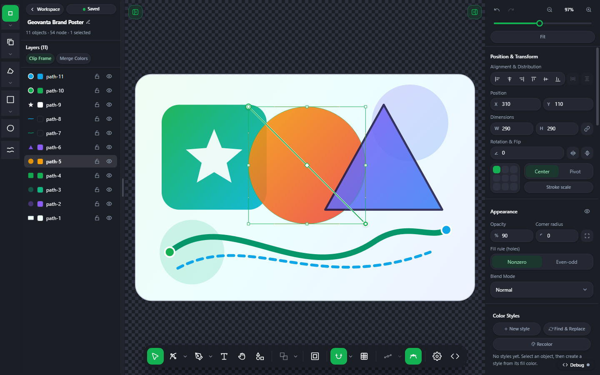

*Geovanta Vector Editor — Mode Gelap yang nyaman di mata untuk sesi desain panjang*

</div>

---

## 🌟 Mengapa Geovanta?

Sebagian besar editor grafis vektor modern memaksa kompromi yang melelahkan: aplikasi berbasis cloud mengunci berkas Anda di balik langganan dan koneksi internet, sementara aplikasi desktop lama terasa berat, kaku, dan tertinggal dari alur kerja frontend serta AI masa kini.

**Geovanta Vector Editor** hadir sebagai jawaban lengkapnya:

| Pilar Utama | Keunggulan yang Anda Dapatkan |
| :--- | :--- |
| 🔒 **100% Offline & Local-First** | Tanpa CDN eksternal dan tanpa wajib login cloud. Semua proyek, kurva Bézier, dan aset gambar tersimpan aman secara lokal di IndexedDB lengkap dengan backup portabel `.geovanta` (ZIP). |
| ⚡ **Performa Setara Native** | Ditenagai kanvas Skia CanvasKit WebAssembly (GPU WebGL + fallback CPU), *Dynamic Interactive LOD*, *spatial indexing*, serta akselerasi geometri Rust/WASM untuk pan & zoom mulus **60+ FPS**. |
| 🎨 **Toolkit Vektor & UI Lengkap** | Mulai dari edit node & handle kurva Bézier, operasi Boolean *Greiner-Hormann*, gradien multi-stop, hingga Auto-Layout bergaya Figma, generator seni generatif *Blob/Weave*, dan editor kode SVG/JSX/Vue dua arah. |
| 🤖 **AI Hibrida via MCP** | Dilengkapi **17 Model Context Protocol (MCP) tools resmi** untuk Antigravity (AGY) & Google Gemini — menggambar langsung di kanvas dengan `Ctrl+Z` Undo/Redo transaksional atau berjalan otonom secara *headless* via CLI. |
| 🌍 **Antarmuka Dwibahasa Penuh** | Beralih seketika antara **Bahasa Indonesia** dan **English**, lengkap dengan tema Terang/Gelap/Sistem serta 20+ pilihan palet warna aksen. |

---

## 🎯 Tur Fitur Visual

### 1. Workspace 100% Offline & Galeri Proyek Lokal
Kelola seluruh proyek ilustrasi Anda secara lokal tanpa server. Dilengkapi filter **Recent**, **All Projects**, **Favorites**, dan **Trash**, pencarian instan, pengurutan, statistik penggunaan IndexedDB secara real-time, pratinjau thumbnail vektor otomatis, *crash recovery*, serta impor/ekspor paket `.geovanta`.


---

### 2. Rangkaian Alat Gambar Lengkap & 20+ Bentuk Parametrik
Gambar bebas maupun presisi geometris memakai **Select (`V`)**, **Pen (`P`)**, **Pencil**, **Brush**, **Curvature**, **Shape Builder**, **Line Segment**, dan **Arc** — dipadukan dengan pustaka cepat berisi **20 bentuk parametrik** (*Persegi, Persegi Bulat, Lingkaran/Elips, Segitiga, Segitiga Siku, Belah Ketupat, Jajar Genjang, Trapesium, Segilima, Segienam, Segidelapan, Bintang 4/5/6, Panah, Chevron, Plus, Hati, Tetesan, dan Cincin*).


---

### 3. Pengeditan Node, Handle & Kurva Bézier Presisi
Masuk ke **Mode Edit Node (`A` / `N` / `Enter`)** untuk membentuk setiap titik jangkar dan tangkai Bézier langsung di atas kanvas. Tersedia alat **Add Node**, **Add Handle**, **Auto Handle (`B`)**, **Straighten & Align Nodes**, **Topological Curve Simplifier** (*RDP & Least-Squares Cubic Bézier Fitting*), **Corner Fillet**, **Compound Path**, serta **Auto-Refine Geometry**.

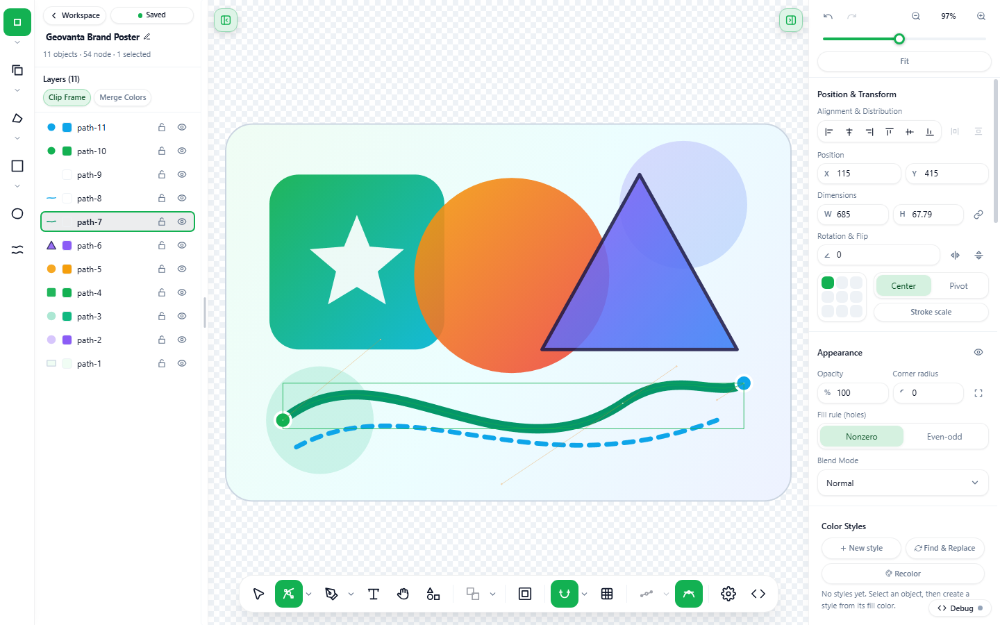

---

### 4. Operasi Boolean (Pathfinder) & Offset Path
Gabungkan atau potong berbagai bentuk vektor secara presisi dengan **Union**, **Subtract**, **Intersect**, **Exclude**, dan **Divide** (berbasis algoritma *Greiner-Hormann clipping* dengan *refit* kurva Bézier otomatis), ditambah **Outline Stroke** dan **Offset Path** — dapat diakses dari floating toolbar, menu klik kanan, maupun pintasan (`Ctrl+Alt+U / S / I / X / D / O`).

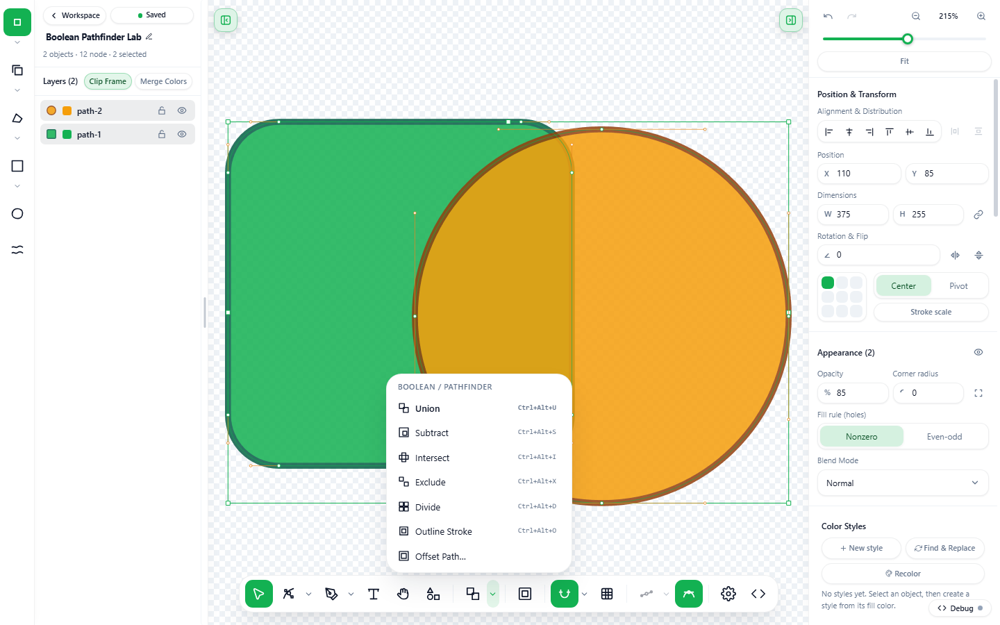

---

### 5. Seni Vektor Generatif — Blob & Weave Generator
Ciptakan bentuk organik (*Blob*) dan pola anyaman geometris (*Weave*) secara parametrik dalam hitungan detik. Atur jumlah titik & ketidakteraturan **Blob**, atau kustomisasi **Weave** (*Sine / Triangle / Square*, jumlah kolom & baris, amplitudo, ketebalan strip, jarak celah, frekuensi, hingga pergeseran fase) secara real-time di Inspector.

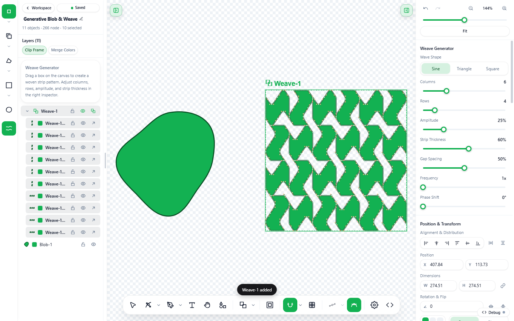

---

### 6. Auto-Layout, Frame Bergaya Figma & Smart Snapping
Pilih beberapa objek lalu tekan **`Shift + A`** untuk membungkusnya menjadi **Auto-Layout Frame** dengan alur **Baris (Row)**, **Kolom (Column)**, atau **Grid**, kontrol alignment 9 titik, jarak antar objek (*gap*), *padding*, dan *Clip Frame*. Penyusunan elemen makin presisi berkat **Figcraft-style Smart Snapping** (garis bantu otomatis, jarak sama rata, ambang batas 5 px, dan *redlines*).

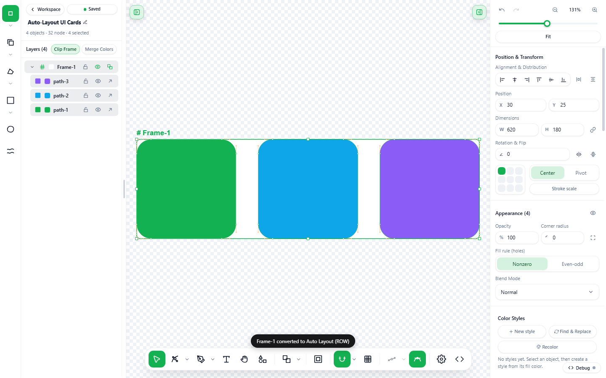

---

### 7. Gradien Multi-Stop, Color Styles, Recolor & Blend Modes
Warnai objek dengan mode **Solid**, **Linear**, **Radial**, dan **Angular** lengkap dengan **Gradient Canvas Gizmo** interaktif langsung di kanvas, kontrol posisi & opasitas tiap *stop*, **Color Styles**, **Recolor Engine**, **Find & Replace Color**, **Screen Pipette**, aturan isian (*Nonzero / Even-odd*), serta **Blend Modes & Efek**.

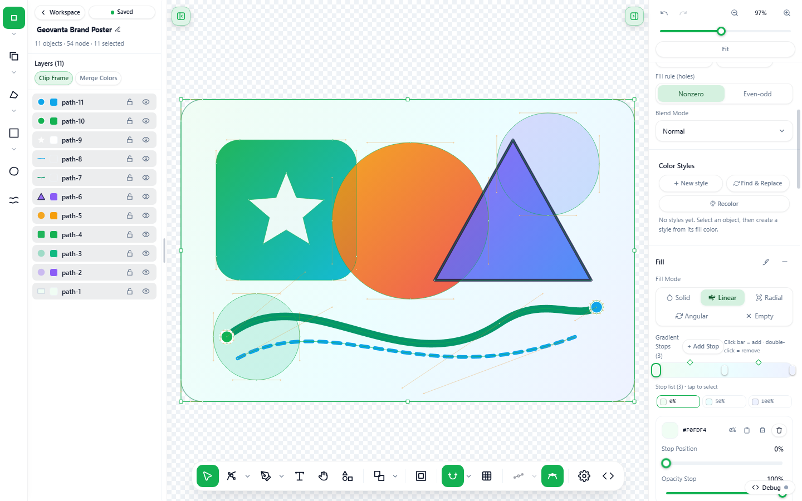

---

### 8. Peramban Ikon Vektor Iconify Bawaan (16.520+ Ikon)
Cari ribuan ikon vektor sumber terbuka dari berbagai kategori dan koleksi (seperti Material Symbols) langsung dari dalam Geovanta, lalu sisipkan sebagai path vektor murni yang langsung bisa diedit di kanvas.

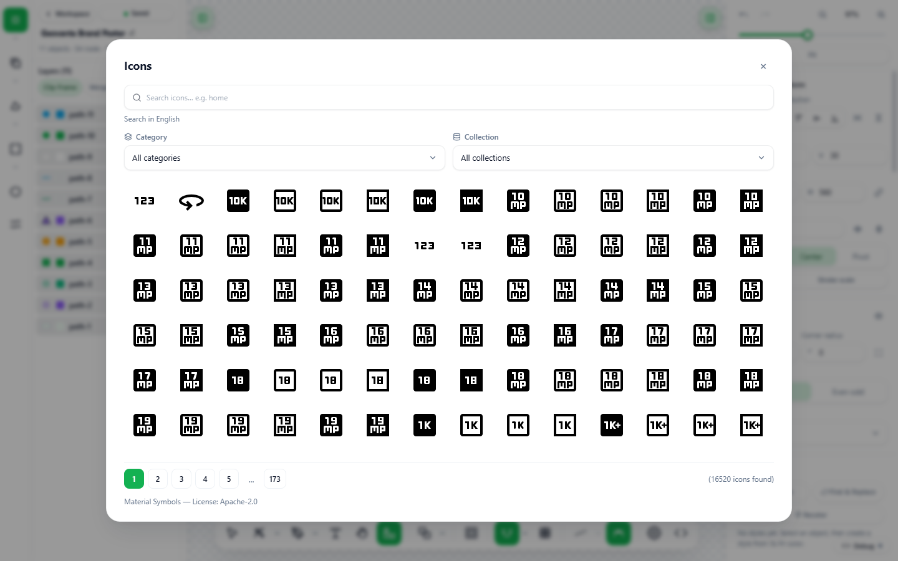

---

### 9. Inspeksi & Editor Kode SVG Dua Arah (Multi-Framework)
Dirancang untuk desainer *sekaligus* developer. Tekan **`Ctrl + Alt + C`** untuk membuka **SVG Code Inspector & Live Editor** dengan sinkronisasi dua arah secara real-time, tombol cepat **Prettify / Minify / Copy / Download**, serta tab keluaran siap pakai untuk:
- **SVG XML (Live)**
- **Web Minified**
- **React JSX**
- **Vue SFC**
- **CSS Data URI**

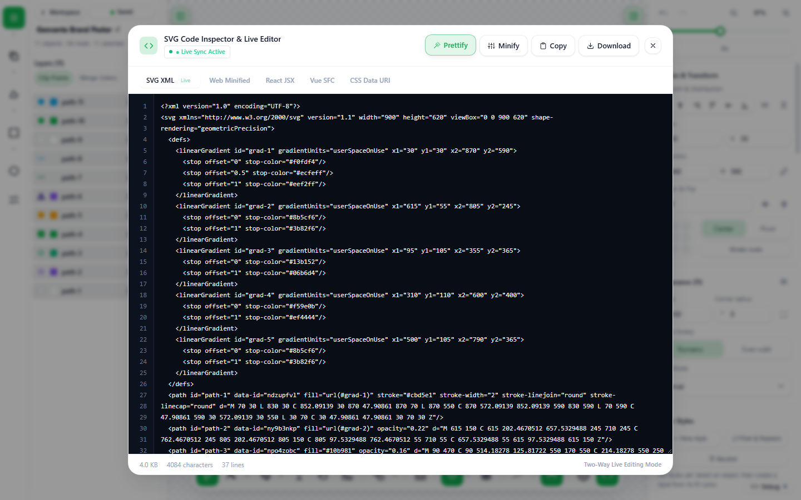

---

### 10. Ekspor Multi-Format, Penghalusan Tepi & Backup Portabel
Ekspor **Artboard**, **Semua Objek**, atau **Seleksi Aktif** ke **SVG**, **PNG**, **JPG**, **WebP** (rasterisasi CPU CanvasKit dengan antialiasing), **AI**, dan **EPS (PostScript)**. Atur latar kanvas **Transparan / Solid**, pilih mode penghalusan tepi (**Kurangi Celah / Standar**), atau simpan **Backup Proyek `.geovanta`**. Teks dari proyek lama tetap dipertahankan dalam mode baca-saja dan ikut diekspor ke SVG, PNG, JPG, dan WebP.

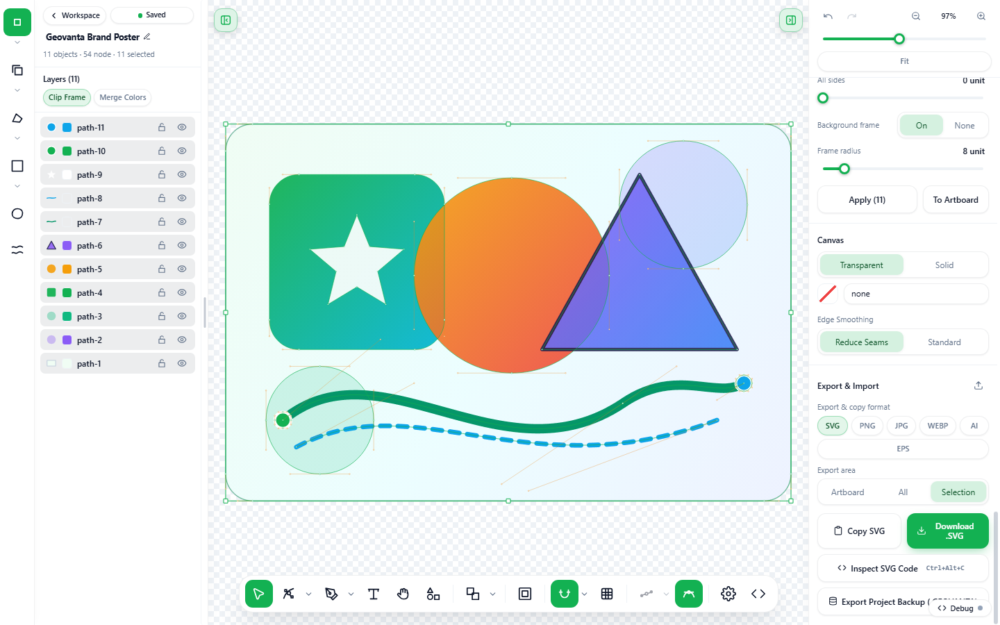

---

### 11. Personalisasi, Tema & Antarmuka Dwibahasa Penuh
Sesuaikan ruang kerja sesuai selera Anda: beralih mulus antara tema **Terang**, **Gelap**, atau **Sistem**, pilih bahasa **Indonesia** atau **English**, serta eksplorasi **20+ palet warna aksen** (*Geovanta, Sistem Windows, Figma Blue, Indigo, Violet, Emerald, Amber, Rose, Slate*, atau kode hex/pipet kustom).

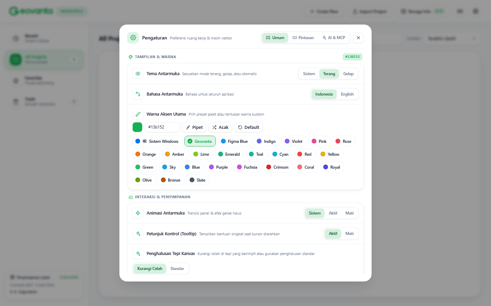

---

## 🤖 Integrasi AI & Model Context Protocol (MCP)

Geovanta dilengkapi server resmi **Model Context Protocol (MCP)** (`scripts/mcp-server/`) untuk menghubungkan kanvas vektor dengan **Antigravity (AGY)** maupun **Google Gemini** (termasuk konektor *Streamable HTTP + OAuth 2.1* untuk Gemini Web).

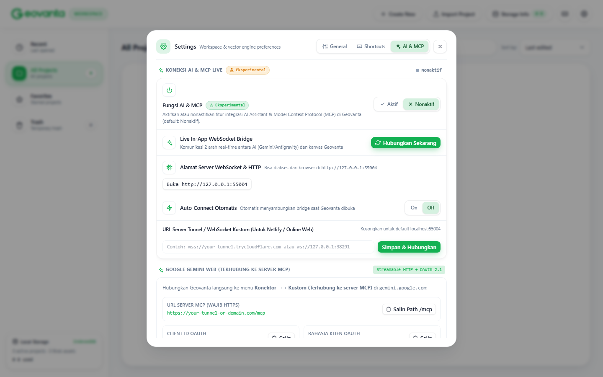

### Arsitektur AI Hibrida: Mode Live vs. Mode Headless
1. **Mode Live (Sinkronisasi Kanvas Real-Time)**: Menghubungkan GUI Geovanta ke server MCP lokal via WebSocket (port bawaan `38291` / URL tunnel kustom). Setiap aksi AI masuk ke riwayat transaksi penuh sehingga Anda bisa membatalkannya kapan saja dengan `Ctrl + Z`.
2. **Mode Headless (Mesin Vektor CLI Mandiri)**: Saat aplikasi GUI ditutup, agen AI tetap dapat mem-parsing SVG, membuat bentuk parametrik, menyederhanakan kurva, menjalankan boolean, fillet sudut, recolor, dan menghasilkan SVG murni lewat `scripts/mcp-server/engineAdapter.js`.

### 17 MCP Tools Resmi

| Kategori | Daftar Tools |
| :--- | :--- |
| **Workspace & Status** | `geovanta_status`, `geovanta_workspace_manage`, `geovanta_artboard_and_view`, `geovanta_layer_manage` |
| **Pembuatan Vektor** | `geovanta_shape_create` *(rect, circle, star, polygon, spiral, blob, weave)*, `geovanta_text_create`, `geovanta_iconify_insert` |
| **Geometri & Warna** | `geovanta_curve_simplify`, `geovanta_boolean_operation`, `geovanta_corner_fillet`, `geovanta_recolor` |
| **SVG & Kanvas Live** | `geovanta_svg_parse`, `geovanta_svg_serialize`, `geovanta_live_get_canvas`, `geovanta_live_mutate_canvas`, `geovanta_live_select_objects`, `geovanta_live_export` |

---

## ⌨️ Pintasan Papan Ketik

Tekan **`?`** kapan saja di kanvas atau buka **Pengaturan → Pintasan** untuk melihat daftar lengkapnya:

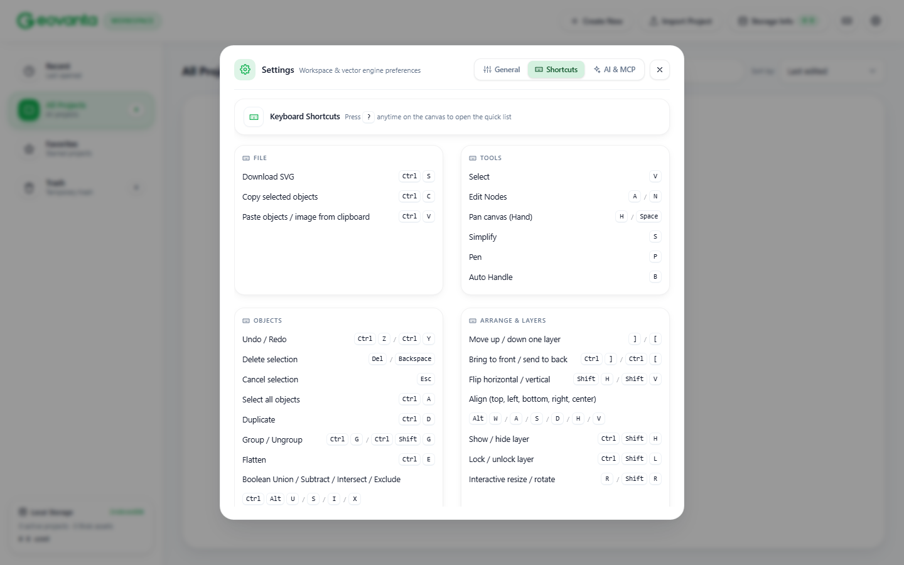

| Kategori | Pintasan | Fungsi |
| :--- | :--- | :--- |
| **Alat** | `V` / `A` atau `N` / `P` / `S` / `B` / `H` atau `Spasi` | Pilih / Edit Node / Pen / Simplify / Auto Handle / Geser Kanvas |
| **Objek** | `Ctrl+Z` / `Ctrl+Y` / `Ctrl+D` / `Ctrl+G` / `Ctrl+Shift+G` | Undo / Redo / Duplikat / Group / Ungroup |
| **Boolean** | `Ctrl+Alt+U` / `S` / `I` / `X` / `O` | Union / Subtract / Intersect / Exclude / Outline Stroke |
| **Frame** | `Ctrl+Alt+G` / `Shift+A` | Buat Frame / Konversi ke Frame Auto-Layout |
| **Layer** | `]` / `[` / `Ctrl+]` / `Ctrl+[` / `Ctrl+Shift+H` / `Ctrl+Shift+L` | Naik/Turun Layer / Paling Depan/Belakang / Sembunyikan / Kunci |
| **Tampilan & Kode** | `0` / `2` / `+` `-` / `Ctrl+Alt+C` / `,` / `?` | Zoom Pas / Zoom Seleksi / Perbesar-Perkecil / Kode SVG / Pengaturan / Bantuan |

---

## 🏗️ Arsitektur

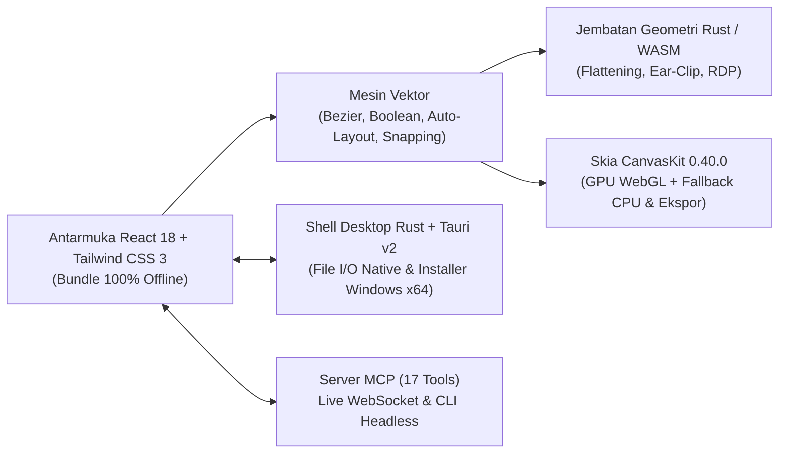

### Struktur Direktori Utama
- `src/` — Kode sumber aplikasi React 18 + TypeScript/TSX (`engine/`, `renderer/`, `components/`, `workspace/`, `constants/`, `utils/`, `bridge/`, `vendor/`)
- `src-tauri/` — Backend Rust & konfigurasi Tauri v2 untuk installer Windows 64-bit (**NSIS `.exe`** & **WiX `.msi`**)
- `rust/` — Modul akselerasi WebAssembly berbasis Rust
- `scripts/mcp-server/` — Server resmi Model Context Protocol (`index.js`, `tools.js`, `engineAdapter.js`)
- `web/` — Bundle web siap pakai 100% offline (`web/index.html` + aset WebAssembly CanvasKit lokal)
- `tests/` — Pengujian unit Node & pengujian E2E/performa Playwright

---

## 🚀 Instalasi & Cara Pakai

### Opsi 1: 🌐 Gunakan WebApp (Tanpa Instalasi)
Buka Geovanta langsung di peramban modern (Chrome, Edge, Firefox) tanpa perlu mengunduh atau memasang apa pun:
- **Live WebApp**: **[https://geovanta.netlify.app](https://geovanta.netlify.app)**

### Opsi 2: 🪟 Pasang Aplikasi Desktop — Windows 64-Bit (Rilis `v1.0.0`)
Unduh installer resmi Windows 64-bit langsung dari **[GitHub Releases (v1.0.0)](https://github.com/zypherianastrid/Geovanta/releases/tag/v1.0.0)**:
1. Unduh [`Geovanta-Vector-Editor_1.0.0_x64-setup.exe`](https://github.com/zypherianastrid/Geovanta/releases/download/v1.0.0/Geovanta-Vector-Editor_1.0.0_x64-setup.exe).
2. Jalankan berkas `.exe` dan ikuti panduan instalasi.
3. Buka **Geovanta Vector Editor** dari Start Menu atau pintasan Desktop.

### Opsi 3: 📦 Jalankan Bundle Offline Secara Lokal (Tanpa Build)
Buka atau jalankan `web/index.html` melalui peramban modern (Chrome / Edge). Seluruh bundle JavaScript dan runtime WebAssembly Skia CanvasKit sudah tersedia secara lokal tanpa koneksi internet.

### Opsi 4: 🛠️ Pengembangan & Build Ulang dari Sumber
```sh
# 1. Pasang dependensi
npm ci

# 2. Jalankan unit test & pengecekan sintaks TypeScript
npm test
npm run typecheck

# 3. Bangun ulang bundle web 100% offline (memperbarui dist/ & web/)
npm run build:web
```

#### Build Installer Desktop Windows 64-Bit (`.exe` & `.msi`)
Membutuhkan **Node.js 20+**, **Rust MSVC** (`x86_64-pc-windows-msvc`), **Visual Studio Build Tools (Desktop development with C++)**, dan **Tauri CLI v2**:
```bat
build-windows-64bit.bat
```
Hasil installer Windows 64-bit akan tersedia di:
- **NSIS Installer (`.exe`)**: `src-tauri\target\x86_64-pc-windows-msvc\release\bundle\nsis\Geovanta Vector Editor_1.1.0_x64-setup.exe`
- **WiX MSI Installer (`.msi`)**: `src-tauri\target\x86_64-pc-windows-msvc\release\bundle\msi\Geovanta Vector Editor_1.1.0_x64_en-US.msi`

*(Build otomatis di GitHub Actions juga sudah disiapkan pada `.github/workflows/build-windows-x64.yml`.)*

---

<div align="center">
  <sub>Dibangun dengan presisi oleh <strong>Geovanta</strong> • Baca dalam <a href="README.md">Bahasa Inggris 🇬🇧</a></sub>
</div>
