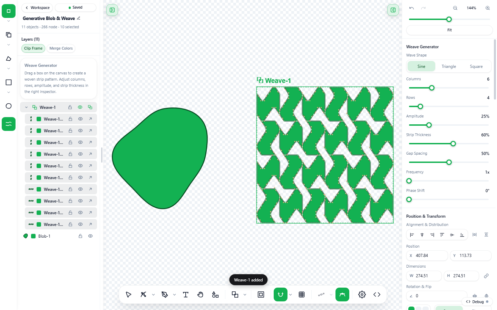
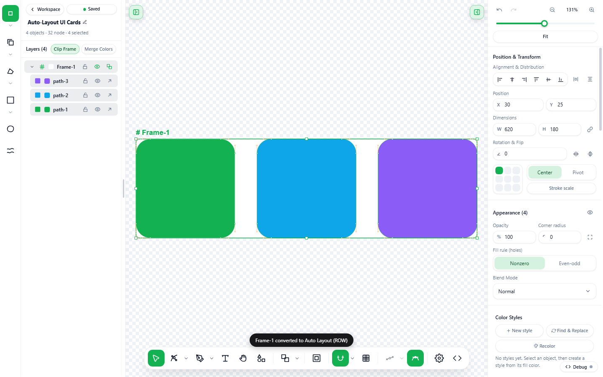
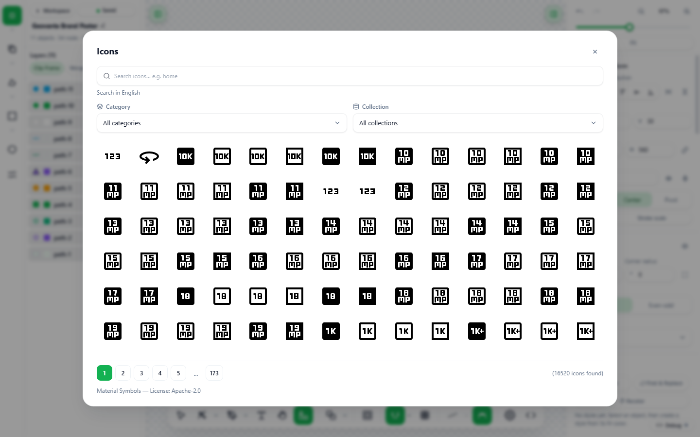
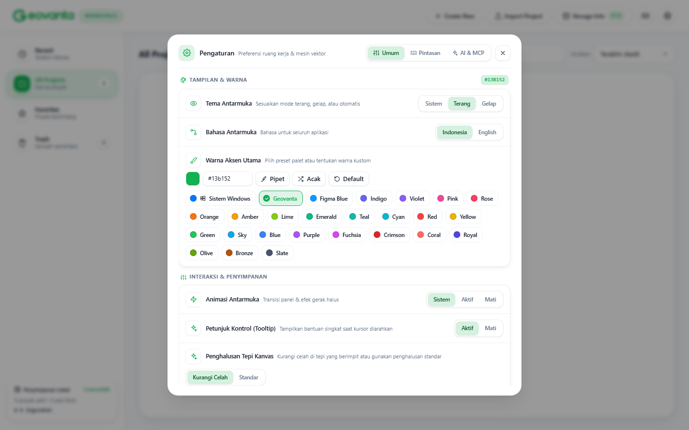
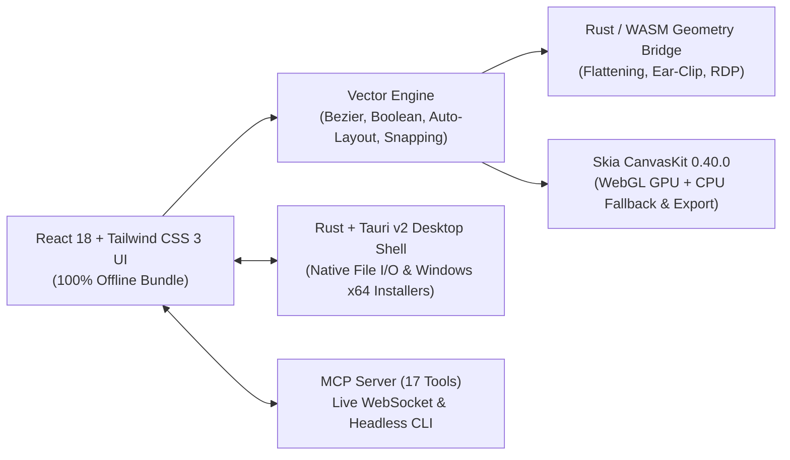

<div align="center">


# Geovanta Vector Editor

**Precision vector design without boundaries — 100% offline, desktop-grade speed, and natively AI-ready.**

<p>
  <a href="README.md"></a>
  <a href="README.id.md"></a>
  <a href="https://geovanta.netlify.app" target="_blank"></a>
  <a href="https://github.com/zypherianastrid/Geovanta/releases/tag/v1.0.0" target="_blank"></a>
</p>

<p>
  
  
  
  
  
  
  
  
  
  <a href="https://geovanta.netlify.app" target="_blank"></a>
</p>

<p>
  <a href="https://geovanta.netlify.app" target="_blank">🌐 WebApp</a> •
  <a href="#-why-geovanta">Why Geovanta</a> •
  <a href="#-visual-feature-tour">Visual Feature Tour</a> •
  <a href="#-ai--model-context-protocol-mcp">AI & MCP</a> •
  <a href="#%EF%B8%8F-keyboard-shortcuts">Shortcuts</a> •
  <a href="#%EF%B8%8F-architecture">Architecture</a> •
  <a href="#-installation--quick-start">Installation</a>
</p>

<br />


*Geovanta Vector Editor — Light Theme with live Gradient Canvas Gizmo, Layer Tree, and Precision Inspector*

<br />


*Geovanta Vector Editor — Dark Theme with full English localization*

</div>

---

## 🌟 Why Geovanta?

Most modern vector editors force a painful trade-off: cloud-only tools lock your files behind subscriptions and internet connections, while legacy desktop apps feel heavy, dated, and disconnected from modern frontend and AI workflows.

**Geovanta Vector Editor** bridges that gap:

| Pillar | What You Get |
| :--- | :--- |
| 🔒 **100% Offline & Local-First** | Zero external CDNs, zero mandatory cloud accounts. Every project, Bézier path, and image blob lives locally in IndexedDB with portable `.geovanta` ZIP backups. |
| ⚡ **Native Desktop Speed** | Powered by a Skia CanvasKit WebAssembly canvas (WebGL GPU + CPU fallback), Dynamic Interactive LOD, spatial indexing, and Rust/WASM geometry acceleration for silky **60+ FPS** panning and zooming. |
| 🎨 **Pro Vector & UI Toolkit** | From cubic Bézier node editing, Greiner-Hormann Booleans, and multi-stop gradients to Figma-style Auto-Layout, generative Blob/Weave patterns, and a two-way live SVG/JSX/Vue code editor. |
| 🤖 **Hybrid AI via MCP** | Ships with **17 official Model Context Protocol (MCP) tools** for Antigravity (AGY) and Google Gemini — work live on the canvas with full transactional `Ctrl+Z` Undo/Redo or run headless in CLI pipelines. |
| 🌍 **Full Bilingual Experience** | Switch effortlessly between **English** and **Bahasa Indonesia**, with Light/Dark/System themes and 20+ customizable accent palettes. |

---

## 🎯 Visual Feature Tour

### 1. 100% Offline Workspace & Project Gallery
Organize all your vector artwork locally with zero server dependency. Filter by **Recent**, **All Projects**, **Favorites**, and **Trash**, search and sort instantly, view live IndexedDB storage metrics, and move projects between devices with `.geovanta` backup archives.


---

### 2. Complete Drawing Suite & 20+ Parametric Shapes
Sketch freely or build geometric precision with **Select (`V`)**, **Pen (`P`)**, **Pencil**, **Brush**, **Curvature**, **Shape Builder**, **Line Segment**, and **Arc** tools — paired with a quick-access library of **20 parametric shapes** (*Rectangle, Rounded Rectangle, Circle/Ellipse, Triangle, Right Triangle, Diamond, Parallelogram, Trapezoid, Pentagon, Hexagon, Octagon, 4/5/6-Point Stars, Arrow, Chevron, Plus, Heart, Droplet, and Ring*).


---

### 3. Precision Node, Handle & Cubic Bézier Editing
Switch into **Node Edit mode (`A` / `N` / `Enter`)** to sculpt every anchor point and tangent handle directly on the canvas. Built-in geometry tools include **Add Node**, **Add Handle**, **Auto Handle (`B`)**, **Straighten & Align Nodes**, **Topological Curve Simplifier (RDP / Least-Squares Cubic Bézier Fitting)**, **Corner Fillet**, **Compound Paths**, and **Auto-Refine Geometry**.


---

### 4. Boolean / Pathfinder Operations & Offset Path
Combine and carve complex shapes cleanly using **Union**, **Subtract**, **Intersect**, **Exclude**, and **Divide** (powered by *Greiner-Hormann polygon clipping* with automatic Bézier refitting), plus **Outline Stroke** and **Offset Path** — accessible from the floating toolbar, context menu, and dedicated shortcuts (`Ctrl+Alt+U / S / I / X / D / O`).


---

### 5. Generative Vector Art — Blob & Weave Generators
Create organic shapes and intricate woven patterns parametrically in seconds. Fine-tune **Blob** points & irregularity or adjust **Weave** wave shapes (*Sine / Triangle / Square*), columns, rows, amplitude, strip thickness, gap spacing, frequency, and phase shift in real time.



---

### 6. Figma-Style Auto-Layout, Frames & Figcraft Smart Snapping
Select any group of elements and press **`Shift + A`** to wrap them into a responsive **Auto-Layout Frame** with **Row**, **Column**, and **Grid** flows, 9-point alignment, gap spacing, symmetric/custom padding, and **Clip Frame**. Align elements effortlessly with **Figcraft-style smart snapping** (alignment guides, equal-spacing detection, 5 px threshold, and redlines).



---

### 7. Multi-Stop Gradients, Color Styles, Recolor & Blend Modes
Style paths with **Solid**, **Linear**, **Radial**, and **Angular** fills — complete with an interactive **Gradient Canvas Gizmo**, multi-stop position & opacity sliders, reusable **Color Styles**, **Recolor Engine**, **Find & Replace Color**, **Screen Pipette**, fill rules (*Nonzero / Even-odd*), and per-object **Blend Modes & Effects**.


---

### 8. Built-In Iconify Vector Icon Browser (16,520+ Icons)
Search across categories and open-source icon collections (including Material Symbols and more) directly inside Geovanta and drop crisp, editable vector paths straight onto your artboard.



---

### 9. Two-Way Live SVG Code Inspector & Multi-Framework Exporter
Built for designers *and* developers. Press **`Ctrl + Alt + C`** to open the **SVG Code Inspector & Live Editor** with real-time two-way synchronization, one-click **Prettify / Minify / Copy / Download**, and instant output tabs for:
- **SVG XML (Live)**
- **Web Minified**
- **React JSX**
- **Vue SFC**
- **CSS Data URI**


---

### 10. Multi-Format Export, Edge Smoothing & Portable Backups
Export your **Artboard**, **All Objects**, or **Current Selection** to **SVG**, **PNG**, **JPG**, **WebP** (CPU CanvasKit rasterization with antialiasing), **AI**, and **EPS (PostScript)**. Toggle **Transparent / Solid** canvas backgrounds, choose **Reduce Seams / Standard** edge smoothing, or export a full **`.geovanta` Project Backup**. Legacy project text is safely preserved in read-only mode and included in SVG/PNG/JPG/WebP exports.


---

### 11. Personalization, Themes & Full Bilingual UI
Tailor the studio to match your workspace: switch seamlessly between **Light**, **Dark**, and **System** themes, toggle between **English** and **Bahasa Indonesia**, and pick from **20+ accent palettes** (*Geovanta Green, Windows System, Figma Blue, Indigo, Violet, Emerald, Amber, Rose, Slate*, and custom hex/pipette).



---

## 🤖 AI & Model Context Protocol (MCP)

Geovanta ships with an official **Model Context Protocol (MCP)** server (`scripts/mcp-server/`) designed for **Antigravity (AGY)** and **Google Gemini** (including Streamable HTTP + OAuth 2.1 connectors for Gemini Web).


### Hybrid Architecture: Live vs. Headless Mode
1. **Live Mode (Real-Time Canvas Sync)**: Connects the running Geovanta GUI to the local MCP server via WebSocket (default port `38291` / custom tunnel URL). Every AI-generated shape, edit, or recolor enters Geovanta's transactional history — undo any AI action instantly with `Ctrl + Z`.
2. **Headless Mode (Standalone CLI Engine)**: Even when the GUI is closed, AI agents can parse SVG, create parametric geometry, simplify curves, run Booleans, fillet corners, recolor palettes, and serialize clean SVG autonomously via `scripts/mcp-server/engineAdapter.js`.

### 17 Official MCP Tools

| Category | Tools |
| :--- | :--- |
| **Workspace & Status** | `geovanta_status`, `geovanta_workspace_manage`, `geovanta_artboard_and_view`, `geovanta_layer_manage` |
| **Vector Creation** | `geovanta_shape_create` *(rect, circle, star, polygon, spiral, blob, weave)*, `geovanta_text_create`, `geovanta_iconify_insert` |
| **Geometry & Color** | `geovanta_curve_simplify`, `geovanta_boolean_operation`, `geovanta_corner_fillet`, `geovanta_recolor` |
| **SVG & Live Canvas** | `geovanta_svg_parse`, `geovanta_svg_serialize`, `geovanta_live_get_canvas`, `geovanta_live_mutate_canvas`, `geovanta_live_select_objects`, `geovanta_live_export` |

---

## ⌨️ Keyboard Shortcuts

Press **`?`** anytime on the canvas or open **Settings → Shortcuts** to view the built-in cheatsheet:


| Category | Shortcut | Action |
| :--- | :--- | :--- |
| **Tools** | `V` / `A` or `N` / `P` / `S` / `B` / `H` or `Space` | Select / Node Edit / Pen / Simplify / Auto Handle / Hand (Pan) |
| **Objects** | `Ctrl+Z` / `Ctrl+Y` / `Ctrl+D` / `Ctrl+G` / `Ctrl+Shift+G` | Undo / Redo / Duplicate / Group / Ungroup |
| **Booleans** | `Ctrl+Alt+U` / `S` / `I` / `X` / `O` | Union / Subtract / Intersect / Exclude / Outline Stroke |
| **Frames** | `Ctrl+Alt+G` / `Shift+A` | Create Frame / Convert to Auto-Layout Frame |
| **Layers** | `]` / `[` / `Ctrl+]` / `Ctrl+[` / `Ctrl+Shift+H` / `Ctrl+Shift+L` | Move Up/Down / Front/Back / Hide / Lock |
| **View & Code** | `0` / `2` / `+` `-` / `Ctrl+Alt+C` / `,` / `?` | Fit Canvas / Zoom Selection / Zoom / SVG Code Inspector / Settings / Shortcuts |

---

## 🏗️ Architecture



### Repository Layout
- `src/` — Core React 18 + TypeScript/TSX application (`engine/`, `renderer/`, `components/`, `workspace/`, `constants/`, `utils/`, `bridge/`, `vendor/`)
- `src-tauri/` — Rust backend & Tauri v2 configuration for 64-bit Windows installers (**NSIS `.exe`** & **WiX `.msi`**)
- `rust/` — Rust WebAssembly acceleration modules
- `scripts/mcp-server/` — Official Model Context Protocol server (`index.js`, `tools.js`, `engineAdapter.js`)
- `web/` — Ready-to-run 100% offline web bundle (`web/index.html` + local CanvasKit WASM assets)
- `tests/` — Node unit tests & Playwright E2E / performance test suite

---

## 🚀 Installation & Quick Start

### Option 1: 🌐 Use the WebApp (Zero Install)
Launch Geovanta directly in any modern browser (Chrome, Edge, Firefox) with no installation required:
- **Live WebApp**: **[https://geovanta.netlify.app](https://geovanta.netlify.app)**

### Option 2: 🪟 Install Desktop App — Windows 64-Bit (`v1.0.0` Release)
Download the official pre-built Windows 64-bit installer from **[GitHub Releases (v1.0.0)](https://github.com/zypherianastrid/Geovanta/releases/tag/v1.0.0)**:
1. Download [`Geovanta-Vector-Editor_1.0.0_x64-setup.exe`](https://github.com/zypherianastrid/Geovanta/releases/download/v1.0.0/Geovanta-Vector-Editor_1.0.0_x64-setup.exe).
2. Run the `.exe` installer and follow the setup wizard.
3. Launch **Geovanta Vector Editor** from your Start Menu or Desktop shortcut.

### Option 3: 📦 Run Offline Bundle Locally (No Build Required)
Serve or open `web/index.html` in Chrome, Edge, or any modern Chromium browser. All JavaScript bundles and Skia CanvasKit WebAssembly runtimes are bundled locally — no internet connection required.

### Option 4: 🛠️ Develop & Build from Source
```sh
# 1. Install dependencies
npm ci

# 2. Run unit tests & TypeScript syntax check
npm test
npm run typecheck

# 3. Rebuild the 100% offline web bundle (updates dist/ and web/)
npm run build:web
```

#### Build Windows 64-Bit Desktop Installers (`.exe` & `.msi`)
Requires **Node.js 20+**, **Rust MSVC** (`x86_64-pc-windows-msvc`), **Visual Studio Build Tools (C++)**, and **Tauri CLI v2**:
```bat
build-windows-64bit.bat
```
Generated 64-bit installers are placed in:
- **NSIS Setup (`.exe`)**: `src-tauri\target\x86_64-pc-windows-msvc\release\bundle\nsis\Geovanta Vector Editor_1.1.0_x64-setup.exe`
- **WiX Installer (`.msi`)**: `src-tauri\target\x86_64-pc-windows-msvc\release\bundle\msi\Geovanta Vector Editor_1.1.0_x64_en-US.msi`

*(Automated CI builds are also preconfigured via `.github/workflows/build-windows-x64.yml`.)*

---

<div align="center">
  <sub>Built with precision by <strong>Geovanta</strong> • Read in <a href="README.id.md">Bahasa Indonesia 🇮🇩</a></sub>
</div>
