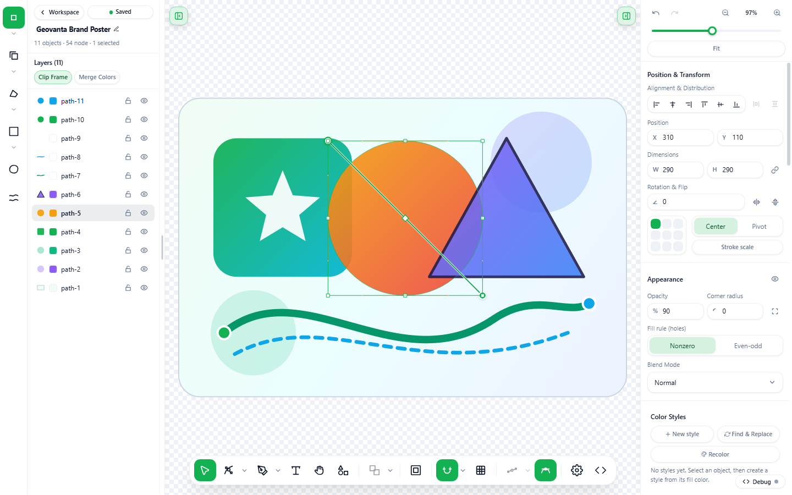
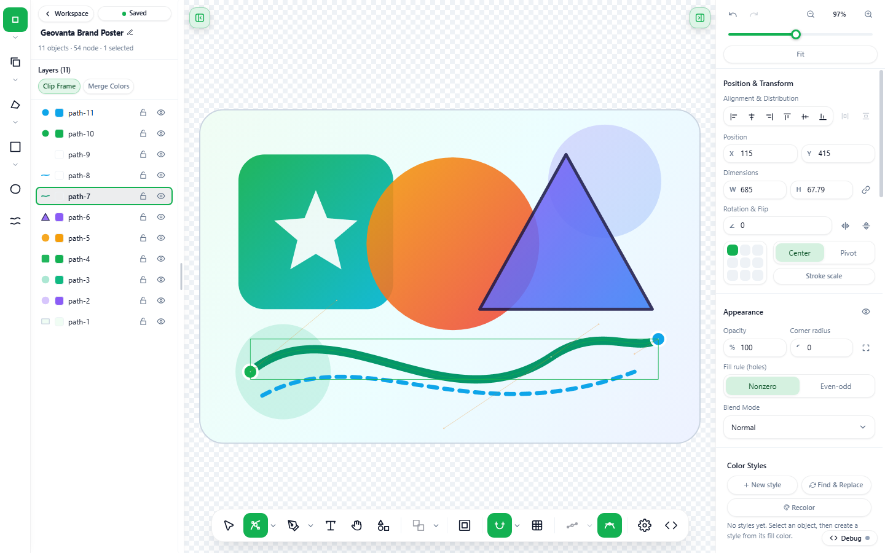
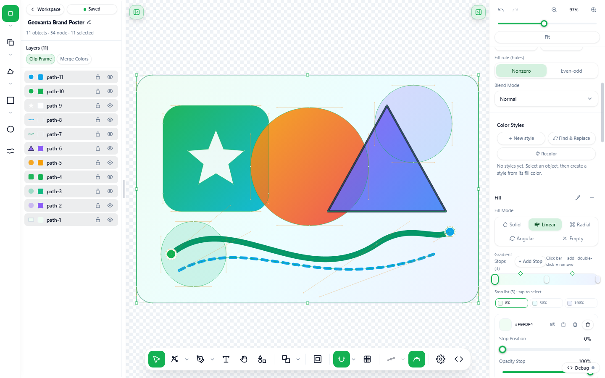
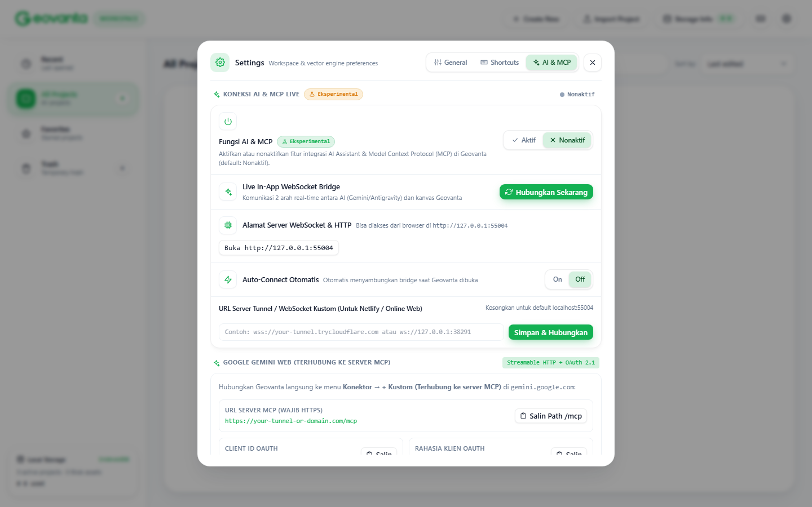
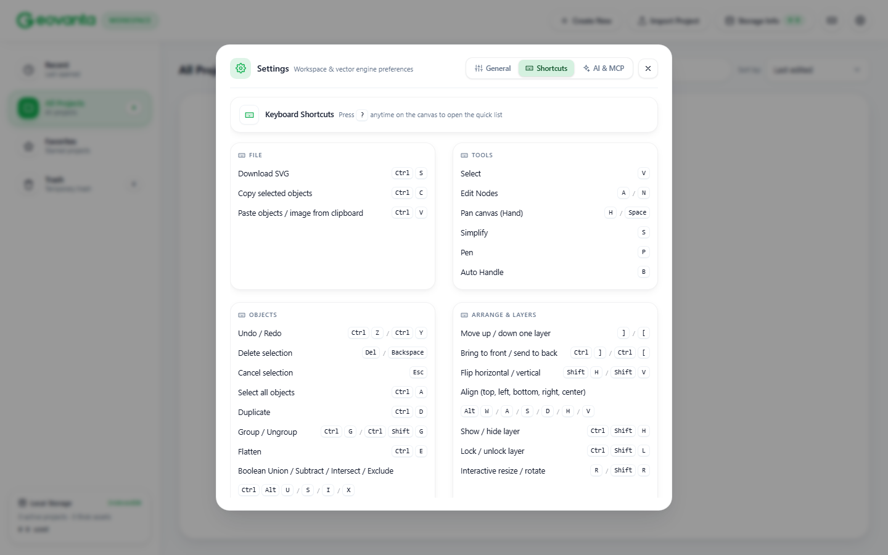
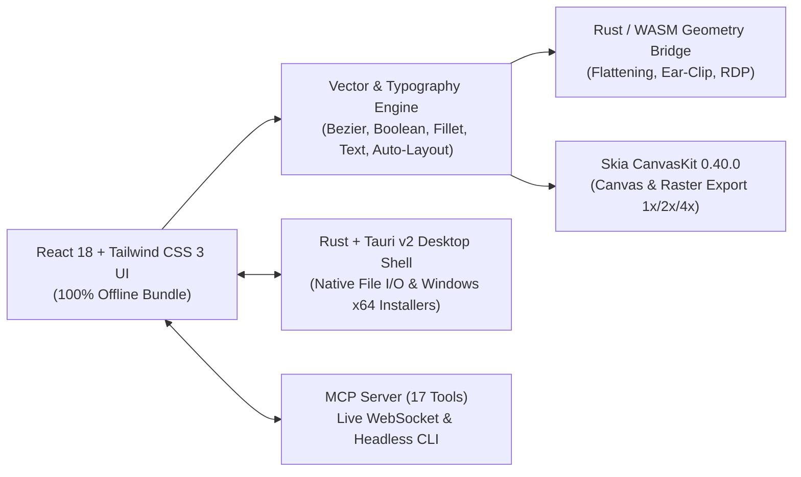

<div align="center">


# Geovanta Vector Editor

**Precision vector design without boundaries — 100% offline, desktop-grade speed, and natively AI-ready.**

<p>
  <a href="README.md"></a>
  <a href="README.id.md"></a>
  <a href="https://geovanta.netlify.app" target="_blank"></a>
  <a href="https://github.com/zypherianastrid/Geovanta/releases/tag/v1.1.0" target="_blank"></a>
  <a href="CHANGELOG.md"></a>
</p>

<p>
  
  
  
  
  
  
  
  
  
  <a href="https://geovanta.netlify.app" target="_blank"></a>
</p>

<p>
  <a href="https://geovanta.netlify.app" target="_blank">🌐 WebApp</a> •
  <a href="#-why-geovanta">Why Geovanta</a> •
  <a href="#-visual-feature-tour">Visual Feature Tour</a> •
  <a href="#-complete-feature-reference">All Features</a> •
  <a href="#-ai--model-context-protocol-mcp">AI & MCP</a> •
  <a href="#%EF%B8%8F-keyboard-shortcuts">Shortcuts</a> •
  <a href="#%EF%B8%8F-architecture">Architecture</a> •
  <a href="#-installation--quick-start">Installation</a>
</p>

<br />



*Geovanta Vector Editor — Light Theme with live Gradient Canvas Gizmo, Virtualized Layer Tree, and Precision Inspector*

<br />


*Geovanta Vector Editor — Dark Theme with full English & Indonesian localization*

</div>

---

## 🌟 Why Geovanta?

Most modern vector editors force a painful trade-off: cloud-only tools lock your files behind subscriptions and internet connections, while legacy desktop apps feel heavy, dated, and disconnected from modern frontend and AI workflows.

**Geovanta Vector Editor** bridges that gap:

| Pillar | What You Get |
| :--- | :--- |
| 🔒 **100% Offline & Local-First** | Zero external CDNs required, zero mandatory cloud accounts. Every project, revision snapshot, custom font, Bézier path, and image blob lives locally in IndexedDB with portable `.geovanta` ZIP backups. |
| 🌐 **Desktop App + Instant WebApp** | Run the native **64-Bit Windows Desktop App** (`.exe` / `.msi` via Rust + Tauri v2) or launch the zero-install **[Live WebApp](https://geovanta.netlify.app)** in any modern browser. |
| ⚡ **Skia & Rust/WASM Speed** | Powered by a Skia CanvasKit 0.40.0 WebAssembly engine, Dynamic Interactive LOD, spatial indexing, geometry caching, and Rust/WASM acceleration for silky **60+ FPS** panning and zooming. |
| 🎨 **Complete Vector, Text & UI Studio** | Cubic Bézier node editing, 3-mode per-corner fillets, Greiner-Hormann Booleans, full vector typography with Google Fonts embedding & text-to-path outlining, dual Fill/Stroke gradients, 16 blend modes, non-destructive effects (`fx`), Figma-style Auto-Layout, and a two-way live SVG/JSX/Vue code editor. |
| 🤖 **Hybrid AI via MCP** | Ships with **17 official Model Context Protocol (MCP) tools** for Antigravity (AGY) and Google Gemini — work live on the canvas with full transactional `Ctrl+Z` Undo/Redo or run headless in CLI pipelines. |
| 🌍 **Full Bilingual Experience** | Switch effortlessly between **English** and **Bahasa Indonesia**, with Light/Dark/System themes, system accent detection, and 20+ customizable accent palettes. |

---

## 🎯 Visual Feature Tour

### 1. 100% Offline Workspace & Project Gallery
Organize all your vector artwork locally with zero server dependency. Filter by **All Projects**, **Recent**, **Favorites**, and **Trash**, search and sort instantly (*Last Modified, Date Created, Name A–Z*), choose artboard presets (`800×600`, `1080×1080`, `1920×1080`, or custom `32–16,384 px`), recover unsaved revisions automatically, inspect live IndexedDB storage metrics, and move projects between devices with `.geovanta` ZIP backup archives.


---

### 2. Complete Drawing Suite & 20+ Parametric Shapes
Sketch freely or build geometric precision with **Select (`V`)**, **Node Edit (`A`/`N`)**, **Pen (`P`)**, **Pencil**, **Brush**, **Curvature**, **Shape Builder**, **Line Segment**, **Parametric Arc**, **Text (`T`)**, **Frame (`Ctrl+Alt+G`)**, and **Hand (`H`/`Space`)** tools — paired with a quick-access library of **20 parametric shapes** (*Rectangle, Rounded Rectangle, Circle/Ellipse, Triangle, Right Triangle, Diamond, Parallelogram, Trapezoid, Pentagon, Hexagon, Octagon, 4/5/6-Point Stars, Arrow, Chevron, Plus, Heart, Droplet, and Ring*).


---

### 3. Precision Node, Handle & Cubic Bézier Editing
Switch into **Node Edit mode (`A` / `N` / `Enter`)** to sculpt every anchor point and tangent handle directly on the canvas. Built-in geometry tools include **Add Node**, **Add Handle**, **Auto Handle (`B`)**, **Straighten & Align Nodes**, **Topological Curve Simplifier (`S` — RDP + Least-Squares Cubic Bézier Fitting)**, **Auto-Simplify Toggle**, **3-Mode Individual Corner Fillet (*Circular / Squircle / Bevel*)**, **16 Node & Path Actions**, **Compound Paths**, **Auto-Refine Geometry**, and adjustable **Node & Handle UI Size (`50%–300%`)**.



---

### 4. Boolean / Pathfinder Operations & Offset Path
Combine and carve complex shapes cleanly using **Union (`Ctrl+Alt+U`)**, **Subtract (`Ctrl+Alt+S`)**, **Intersect (`Ctrl+Alt+I`)**, **Exclude (`Ctrl+Alt+X`)**, and **Divide (`Ctrl+Alt+D`)** (powered by *Greiner-Hormann polygon clipping* with automatic cubic Bézier refitting), plus **Outline Stroke (`Ctrl+Alt+O`)**, **Interactive Offset Path Strip**, and **Flatten (`Ctrl+E`)**.


---

### 5. Generative Vector Art — Parametric Blob, Weave & Arc Generators
Create organic shapes, intricate woven patterns, and exact circular arcs parametrically in seconds:
- **Blob Generator**: Adjust *Points (`3–48`), Irregularity (`0–100%`), Smoothness (`0–100%`), Rotation (`0–360°`), Spikiness (`0–100%`), numeric Seed*, and one-click *Randomize*.
- **Weave Generator**: Choose *Wave Type (`Sine / Triangle / Square`)* and tune *Columns (`2–16`), Rows (`2–16`), Amplitude (`0–100%`), Strip Thickness (`10–100%`), Gap Spacing (`0–100%`), Frequency (`1x–4x`), and Phase Shift (`0–360°`)* in real time.
- **Parametric Arc**: Live-edit *Radius (`1–500`), Start Angle (`0–360°`), and Sweep Angle (`0–360°`)* non-destructively.


---

### 6. Figma-Style Auto-Layout, Frames & 10-Mode Figcraft Smart Snapping
Select any group of elements and press **`Shift + A`** to wrap them into a responsive **Auto-Layout Frame** with **Row**, **Column**, and **Grid (Wrap `1–10` cols)** flows, 9-point alignment pin grid, gap spacing, **Symmetric** or **4-Side Independent Padding (`T/R/B/L`)**, optional frame background & corner radius, **Clip Frame**, and **Fit to Artboard**. Align elements effortlessly with the **10-Mode Figcraft Smart Snapping Matrix** and live redline distance indicators.


---

### 7. Dual Fill/Stroke Gradients, Color Styles, Recolor, Blend Modes & Effects (`fx`)
Style paths with **Solid**, **Linear**, **Radial**, and **Angular (Conic)** paints independently on **both Fill and Stroke** — complete with an interactive **Gradient Canvas Gizmo**, multi-stop position & opacity sliders, reusable document **Color Styles**, **Paint Copy/Paste Clipboard**, **Recolor Engine**, **Find & Replace Color**, **Selection Colors & Select Same (`Fill / Stroke / Type`)**, **Screen Pipette**, fill rules (*Nonzero / Even-odd*), **16 Blend Modes**, and stackable **Drop Shadow / Layer Blur / Background Blur** effects.



---

### 8. Built-In Iconify Vector Icon Browser (16,520+ Icons)
Search across categories and open-source icon collections (including Material Symbols, Lucide, MDI, and more) directly inside Geovanta and drop crisp, editable vector paths straight onto your artboard.


---

### 9. Two-Way Live SVG Code Inspector & Multi-Framework Exporter
Built for designers *and* developers. Press **`Ctrl + Alt + C`** to open the **SVG Code Inspector & Live Editor** with real-time two-way synchronization, one-click **Prettify / Minify / Copy / Download**, and instant output tabs for:
- **SVG XML (Live)**
- **Web Minified**
- **React JSX**
- **Vue SFC**
- **CSS Data URI**


---

### 10. Multi-Format Export (`SVG`, `PNG`, `JPG`, `WEBP`, `AI`, `EPS`), Import & Portable Backups
Export your **Artboard**, **All Objects**, or **Current Selection** to **SVG**, **PNG**, **JPG**, **WebP** (Skia CanvasKit CPU rasterization at **`1x`**, **`2x (HD)`**, or **`4x (Ultra)`**), **Adobe Illustrator (`.AI`)**, and **Encapsulated PostScript (`.EPS`)**. Copy directly to the system clipboard or download as a file, toggle **Transparent / Solid** canvas backgrounds, choose **Edge Smoothing (Antialiasing / Reduce Seams)** vs. **1×1 Pixel Preview**, import **12+ vector/raster/font formats**, or export a full **`.geovanta` Project Backup**.


---

### 11. Personalization, Performance Telemetry, Themes & Full Bilingual UI
Tailor the studio to match your workflow: switch seamlessly between **Light**, **Dark**, and **System** themes, toggle between **English** and **Bahasa Indonesia**, pick from **20+ accent palettes** (*Geovanta Green, Windows System Auto-Detect, Figma Blue, Indigo, Violet, Emerald, Amber, Rose, Slate*, or custom hex/pipette), and run the built-in **Performance Benchmark Suite & Geometry Cache Telemetry**.


---

## 📋 Complete Feature Reference

> For the chronological release history, see **[CHANGELOG.md](CHANGELOG.md)**.

### 🔤 Typography & Vector Text Engine
| Capability | Details |
| :--- | :--- |
| **On-Canvas & Live Inspector Editing** | Double-click any text object or click **Edit on Canvas** for direct caret editing, or edit inside the **Typography Inspector** with real-time canvas preview and single-step transactional Undo commit (`Ctrl+Enter` / blur; `Escape` to cancel). |
| **Bundled & Custom Fonts** | Ships offline with **IBM Plex Sans** (*Regular, Italic, Bold, Bold Italic*). Import any local **`.TTF` or `.OTF`** font file directly into the project's IndexedDB asset store. |
| **Google Fonts Auto-Embed** | Browse and search the built-in **Google Fonts** catalog with live font-face dropdown previews; selecting a Google Font automatically downloads and embeds the font binary into the project for 100% offline portability. |
| **Missing Font Recovery** | Automatically detects unbundled fonts in imported projects, preserves the original font family metadata, and provides one-click **Import `.TTF/.OTF`** or **Use IBM Plex Sans** fallback. |
| **Font Weight, Style & Size** | Choose **Regular**, **Medium (`500`)**, **SemiBold (`600`)**, or **Bold**, toggle quick **Bold (`B`)** and **Italic (`I`)** buttons, and set font size from **`1 px` to `10,000 px`**. |
| **Precision Spacing Metrics** | 3-column Figma-style metrics: **Line Height (`0.5–5.0`)**, **Letter Spacing (`-200` to `1,000 px`)**, and **Paragraph Spacing (`0–1,000 px`)**. |
| **3 Text Box Resizing Modes** | **Auto Width (`Auto W`)** (point text that expands horizontally), **Auto Height (`Auto H`)** (fixed width wrapping paragraphs vertically), and **Fixed Size (`Fixed`)** (explicit `W × H` bounding box). |
| **Horizontal & Vertical Alignment** | Horizontal: **Align Left**, **Align Center**, **Align Right**, **Justify**. Vertical: **Align Top**, **Align Middle**, **Align Bottom**. |
| **Text Case & Decoration** | Case: **As Typed (`—`)**, **Uppercase (`AG`)**, **Lowercase (`ag`)**, **Title Case (`Ag`)**. Decoration: **None (`—`)**, **Underline (`U`)**, **Strikethrough (`S`)**. |
| **Convert Text to Path (`Outline`)** | One-click **Convert to Path (`Outline`)** powered by `opentype.js` turns glyph contours into editable cubic Bézier vector paths (also performed automatically during `.AI` and `.EPS` export). |

### 📤 Export, Import & Code Interoperability
| Feature | Supported Options |
| :--- | :--- |
| **Vector Export Formats** | **`.SVG`** (standards-compliant vector XML), **`.AI`** (Adobe Illustrator PDF-compatible vector document), **`.EPS`** (Encapsulated PostScript with automatic text outlining & round-trip metadata). |
| **Raster Export Formats & Scaling** | **`.PNG`** (with alpha transparency), **`.JPG`**, and **`.WEBP`** rendered via Skia CanvasKit CPU at **`1x`**, **`2x (HD)`**, or **`4x (Ultra)`** resolution multipliers. |
| **Export Area Scopes** | **Artboard (`board`)** (clips to artboard bounds), **All Objects (`content`)** (tight bounding box of all visible artwork), or **Selection Only (`sel`)** (exports only currently selected objects). |
| **Clipboard Copy vs. File Download** | **Copy** button writes `.SVG` / `.AI` / `.EPS` source code or high-DPI `.PNG` image data directly to the system clipboard; **Download** button saves the file to disk. |
| **Two-Way Live Code Inspector (`Ctrl+Alt+C`)** | Edit SVG XML live with instant canvas reflection, **Prettify**, **Minify**, **Copy**, **Download**, and switch between **SVG XML (Live)**, **Web Minified**, **React JSX**, **Vue SFC**, and **CSS Data URI**. |
| **Multi-Format Import & Paste** | Import **`.SVG`, `.AI`, `.EPS`, `.PS`, `.PDF`, `.PNG`, `.JPG`, `.JPEG`, `.WEBP`, `.GIF`, `.TTF`, `.OTF`** via file picker or drag-and-drop, plus direct clipboard paste (`Ctrl+V`). |
| **Canvas Background & Edge Smoothing** | Toggle **Transparent** checkerboard vs. **Solid Color** background; toggle **Edge Smoothing (Antialiasing / Reduce Seams)** vs. crisp **1×1 Pixel Preview**. |
| **Portable `.geovanta` Project Backup** | One-click **Export Backup (`.geovanta`)** packages the full project JSON, revision history, embedded fonts, and raster image assets into a single portable ZIP archive. |

### 🎨 Fill, Stroke, Gradients, Color Systems & Effects (`fx`)
| Subsystem | Capabilities |
| :--- | :--- |
| **Dual Fill & Stroke Paint Slots** | Apply **Solid Color**, **Linear Gradient**, **Radial Gradient**, **Angular (Conic) Gradient**, or **None** independently to both **Fill** and **Stroke**, with on-canvas **Gradient Gizmo** focus switching. |
| **Stroke Engineering** | **Width (`0–10,000 px`)**, **Scale Stroke with Object**, **Stroke Alignment** (*Center / Inside / Outside*), **Paint Order** (*Fill in Front / Stroke in Front*), **Line Cap** (*Round / Butt / Square*), **Line Join** (*Round / Miter with `1x–100x` Miter Limit / Bevel*), **Dash Presets** (*Solid / Dashed / Dotted / Dash-Dot / Custom Dash Array*), and **Dash Offset (`-100` to `+100 px`)**. |
| **Color Styles & Paint Clipboard** | Create linked document **Color Styles**, live-scrub a style to update all linked objects at once, sample any pixel with the **Screen Pipette**, pick **Recent Colors**, and **Copy / Paste Solid or Gradient Paint** across objects. |
| **Selection Colors, Recolor & Find/Replace** | View every color in the active selection, click **Select Same Fill / Stroke / Type**, run **Find & Replace Color**, or shift palettes with the interactive **Recolor Artwork** engine. |
| **16 Blend Modes** | *Normal*, *Darken*, *Multiply*, *Color Burn*, *Lighten*, *Screen*, *Color Dodge*, *Overlay*, *Soft Light*, *Hard Light*, *Difference*, *Exclusion*, *Hue*, *Saturation*, *Color*, and *Luminosity*. |
| **Stackable Layer Effects (`fx`)** | Non-destructive **Drop Shadow** (`dx`, `dy`, `blur`, `color`, `opacity`), **Layer Blur** (`0–100 px` Gaussian blur), and **Background Blur** (`0–100 px` backdrop blur) with per-effect toggle and delete. |

### 📐 Corner Fillet, Node Actions, Snapping & Layer Organization
| Subsystem | Capabilities |
| :--- | :--- |
| **3-Mode Corner Fillet Engine** | Uniform or per-vertex (`#1`, `#2`, …) corner rounding in **Circular**, **Squircle (Cubic Bézier)**, or **Bevel (Chamfer)** mode, with **All**, **Odd**, **Even**, and **Sharpen (`0`)** quick selectors. |
| **16 Node & Path Actions** | *Delete Node, Smooth, Corner, Symmetric, Auto-Smooth, Break Handles (Free Curve), Join Endpoints, Split Path, Close Path, Open Path, Reverse Direction, Straighten, Simplify (`S`), Convert to Curves, Outline Stroke (`Ctrl+Alt+O`), and Offset Path*. |
| **10-Mode Smart Snapping Matrix** | *Smart Guides (Box & Center), Equal Spacing, Artboard Edges & Center, Node & Handle Points, Node Axis Alignment (X/Y), Segment Midpoint, Path Contour / Edges, Right Angle (`90°`) & Line Extension, Adaptive Grid Lines, and Snap to Pixel (`1 px`)* with **All / Minimal / Default** presets. |
| **9-Point Pin Grid & 8-Way Align** | Transform `X, Y, W, H, ∠` around **Center** or any **9-Point Pin Grid** anchor; **Lock Aspect Ratio**; **Flip H/V (`Shift+H/V`)**; **Align Left / Center / Right / Top / Middle / Bottom** (`Alt+W/A/S/D/H/V`) & **Distribute Horizontal / Vertical**. |
| **Virtualized Layer Tree & Color Buckets** | 60 FPS virtualized layer hierarchy with drag-and-drop nesting into Groups/Frames, child ejection, inline rename, lock/hide, node-count badges, and **Group by Same Color** mode. |

---

## 🤖 AI & Model Context Protocol (MCP)

Geovanta ships with an official **Model Context Protocol (MCP)** server (`scripts/mcp-server/`) designed for **Antigravity (AGY)** and **Google Gemini** (including Streamable HTTP + OAuth 2.1 connectors for Gemini Web).



### Hybrid Architecture: Live vs. Headless Mode
1. **Live Mode (Real-Time Canvas Sync)**: Connects the running Geovanta GUI to the local MCP server via WebSocket (default port `38291` / custom tunnel URL). Every AI-generated shape, text element, edit, or recolor enters Geovanta's transactional history — undo any AI action instantly with `Ctrl + Z`.
2. **Headless Mode (Standalone CLI Engine)**: Even when the GUI is closed, AI agents can parse SVG, create parametric geometry, simplify curves, run Booleans, fillet corners, recolor palettes, and serialize clean SVG autonomously via `scripts/mcp-server/engineAdapter.js`.

### 17 Official MCP Tools

| Category | Tools |
| :--- | :--- |
| **Workspace & Status** | `geovanta_status`, `geovanta_workspace_manage`, `geovanta_artboard_and_view`, `geovanta_layer_manage` |
| **Vector & Text Creation** | `geovanta_shape_create` *(rect, circle, star, polygon, spiral, blob, weave)*, `geovanta_text_create`, `geovanta_iconify_insert` |
| **Geometry & Color** | `geovanta_curve_simplify`, `geovanta_boolean_operation`, `geovanta_corner_fillet`, `geovanta_recolor` |
| **SVG & Live Canvas** | `geovanta_svg_parse`, `geovanta_svg_serialize`, `geovanta_live_get_canvas`, `geovanta_live_mutate_canvas`, `geovanta_live_select_objects`, `geovanta_live_export` |

---

## ⌨️ Keyboard Shortcuts

Press **`?`** anytime on the canvas or open **Settings → Shortcuts** to view the built-in cheatsheet:



| Category | Shortcut | Action |
| :--- | :--- | :--- |
| **File & Code** | `Ctrl+S` / `Ctrl+C` / `Ctrl+V` / `Ctrl+Alt+C` | Download SVG / Copy Selection / Paste Objects or Image / Live SVG Code Inspector |
| **Tools** | `V` / `A` or `N` / `P` / `S` / `B` / `H` or `Space` | Select / Node Edit / Pen / Simplify / Auto Handle / Hand (Pan) |
| **Objects** | `Ctrl+Z` / `Ctrl+Y` / `Ctrl+A` / `Ctrl+D` / `Del` / `Esc` | Undo / Redo / Select All / Duplicate / Delete Selection / Cancel Selection |
| **Groups & Frames** | `Ctrl+G` / `Ctrl+Shift+G` / `Ctrl+Alt+G` / `Shift+A` / `Ctrl+E` | Group / Ungroup / Create Frame / Auto-Layout Frame / Flatten |
| **Booleans & Paths** | `Ctrl+Alt+U` / `S` / `I` / `X` / `D` / `O` / `Enter` | Union / Subtract / Intersect / Exclude / Divide / Outline Stroke / Enter Node Edit |
| **Arrange & Align** | `]` / `[` / `Ctrl+]` / `Ctrl+[` / `Shift+H` / `Shift+V` / `Alt+W,A,S,D,H,V` | Up/Down 1 Layer / Front/Back / Flip H/V / Align Top, Left, Bottom, Right, Center |
| **Layer & Opacity** | `Ctrl+Shift+H` / `Ctrl+Shift+L` / `R` or `Shift+R` / `0…9` | Show/Hide Layer / Lock/Unlock Layer / Interactive Resize or Rotate / Opacity `10%–100%` |
| **View & Help** | `0` / `2` / `Shift+1` / `+` `-` / `Arrow Keys` / `,` / `?` / `Ctrl+Shift+D` | Fit Canvas / Zoom Selection / Zoom Fit / Zoom In-Out / Nudge (`Shift` = `10 px`) / Settings / Shortcuts / Debug Mode |

---

## 🏗️ Architecture



### Repository Layout
- `src/` — Core React 18 + TypeScript/TSX application (`engine/`, `renderer/`, `components/`, `workspace/`, `constants/`, `utils/`, `bridge/`, `vendor/`, `assets/fonts/`, `data/`)
- `src-tauri/` — Rust backend & Tauri v2 configuration for 64-bit Windows installers (**NSIS `.exe`** & **WiX `.msi`**)
- `rust/` — Rust WebAssembly geometry acceleration modules
- `scripts/mcp-server/` — Official Model Context Protocol server (`index.js`, `tools.js`, `engineAdapter.js`)
- `web/` — Ready-to-run 100% offline web bundle (`web/index.html` + local CanvasKit WASM assets)
- `tests/` — Node unit tests & Playwright E2E / performance test suite
- `CHANGELOG.md` — Complete release notes and feature catalog starting from `v1.0.0`

---

## 🚀 Installation & Quick Start

### Option 1: 🌐 Use the WebApp (Zero Install)
Launch Geovanta directly in any modern browser (Chrome, Edge, Firefox) with no installation required:
- **Live WebApp**: **[https://geovanta.netlify.app](https://geovanta.netlify.app)**

### Option 2: 🪟 Install Desktop App — Windows 64-Bit (`v1.1.0` Release)
Download the official pre-built Windows 64-bit installer from **[GitHub Releases (v1.1.0)](https://github.com/zypherianastrid/Geovanta/releases/tag/v1.1.0)**:
1. Download [`Geovanta-Vector-Editor_1.1.0_x64-setup.exe`](https://github.com/zypherianastrid/Geovanta/releases/download/v1.1.0/Geovanta-Vector-Editor_1.1.0_x64-setup.exe).
2. Run the `.exe` installer and follow the setup wizard.
3. Launch **Geovanta Vector Editor** from your Start Menu or Desktop shortcut.

### Option 3: 📦 Run Offline Bundle Locally (No Build Required)
Serve or open `web/index.html` in Chrome, Edge, or any modern Chromium browser. All JavaScript bundles, fonts, and Skia CanvasKit WebAssembly runtimes are bundled locally — no internet connection required.

### Option 4: 🛠️ Develop & Build from Source
```sh
# 1. Install dependencies
npm ci

# 2. Run unit tests & TypeScript syntax check
npm test
npm run typecheck

# 3. Rebuild the 100% offline web bundle (updates dist/ and web/)
npm run build:web
```

#### Build Windows 64-Bit Desktop Installers (`.exe` & `.msi`)
Requires **Node.js 20+**, **Rust MSVC** (`x86_64-pc-windows-msvc`), **Visual Studio Build Tools (C++)**, and **Tauri CLI v2**:
```bat
build-windows-64bit.bat
```
Generated 64-bit installers are placed in:
- **NSIS Setup (`.exe`)**: `src-tauri\target\x86_64-pc-windows-msvc\release\bundle\nsis\Geovanta Vector Editor_1.1.0_x64-setup.exe`
- **WiX Installer (`.msi`)**: `src-tauri\target\x86_64-pc-windows-msvc\release\bundle\msi\Geovanta Vector Editor_1.1.0_x64_en-US.msi`

---

## 👥 Contributors

<table>
  <tr>
    <td align="center">
      <a href="https://github.com/zypherianastrid">
        <br />
        <sub><b>zyphee (@zypherianastrid)</b></sub>
      </a><br />
      <sub>Creator, Lead Architect & Maintainer</sub>
    </td>
  </tr>
</table>

---

<div align="center">
  <sub>Built with precision by <strong>Geovanta</strong> (<a href="https://github.com/zypherianastrid">@zypherianastrid</a>) • <a href="CHANGELOG.md">Changelog</a> • Read in <a href="README.id.md">Bahasa Indonesia 🇮🇩</a></sub>
</div>
