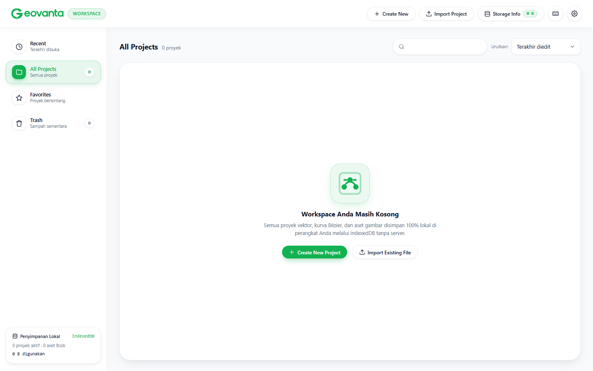
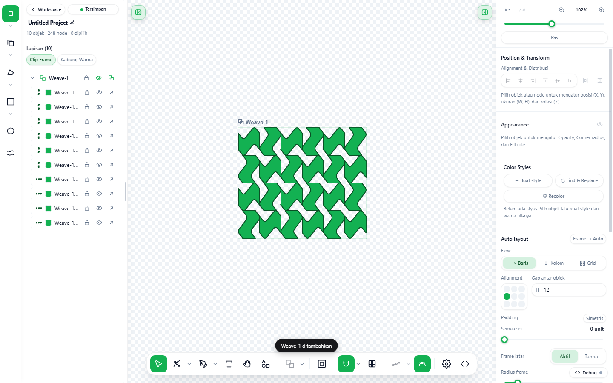
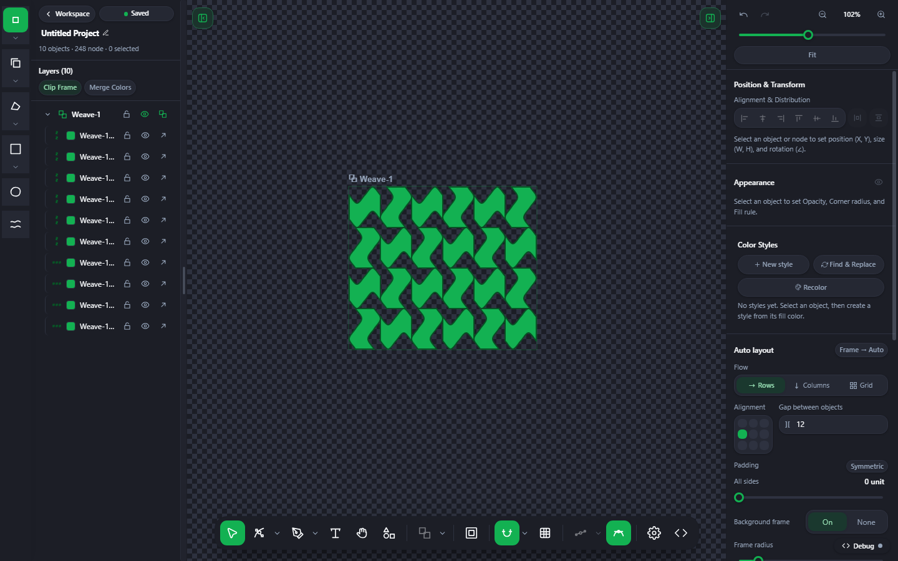
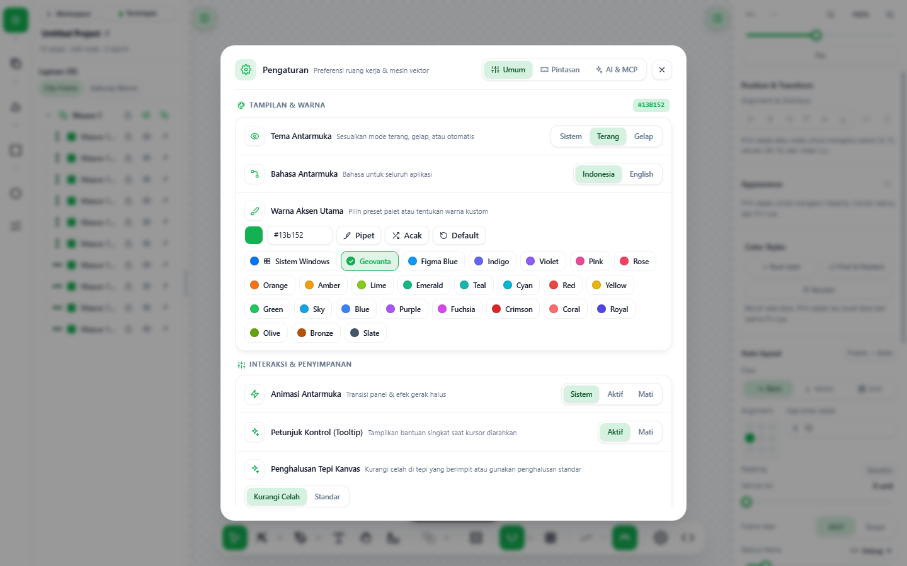

<div align="center">

# Geovanta Vector Studio

**Aplikasi Editor Grafis Vektor Modern Berbasis Rust + Tauri v2, React 18, & Skia CanvasKit (WebAssembly)**  
*Modern Vector Graphics Studio Powered by Rust + Tauri v2, React 18, & Skia CanvasKit (WebAssembly)*

[](#-bahasa-indonesia)
[](#-english)

</div>

---

## 📸 Tangkapan Layar / Screenshots

### 1. Workspace Home (Offline Project Gallery)


### 2. Vector Editor — Light Theme (Bahasa Indonesia)


### 3. Vector Editor — Dark Theme (English UI)


### 4. Settings & Customization (Themes, Bilingual UI, Accent Colors)


---

## 🇮🇩 Bahasa Indonesia

### Ringkasan
**Geovanta Vector Studio** adalah aplikasi desain dan ilustrasi vektor lintas platform (dioptimalkan untuk desktop **Windows 64-bit** menggunakan **Rust + Tauri v2**) yang berjalan **100% offline** tanpa ketergantungan CDN maupun server eksternal. Mesin grafisnya memadukan **React 18**, **Tailwind CSS 3**, **Skia CanvasKit 0.40.0 (WebAssembly)**, serta akselerasi **Rust/WASM** untuk menghadirkan pengalaman menggambar kurva Bézier, operasi boolean, auto-layout, hingga integrasi AI melalui **Model Context Protocol (MCP)**.

### ✨ Fitur Lengkap

1. **Workspace & Manajemen Proyek 100% Offline**
   - **Penyimpanan Lokal IndexedDB**: Semua proyek vektor, kurva Bézier, dan aset gambar disimpan lokal di perangkat melalui `workspaceDb`.
   - **Organisasi Proyek**: Filter *Recent*, *All Projects*, *Favorites*, dan *Trash*, lengkap dengan pencarian, pengurutan, serta pratinjau thumbnail otomatis.
   - **Backup & Pemulihan**: Ekspor/impor paket proyek `.geovanta` (ZIP) untuk pindah perangkat, serta dialog pemulihan otomatis (*crash recovery*).

2. **Alat Gambar Vektor & Pustaka Bentuk Parametrik**
   - **Alat Gambar Lengkap**: *Select (`V`)*, *Pen*, *Pencil*, *Brush*, *Curvature*, *Shape Builder*, *Line Segment*, *Arc*, *Blob Generator*, dan *Weave Generator*.
   - **20+ Bentuk Parametrik**: *Persegi*, *Persegi Bulat*, *Lingkaran/Elips*, *Segitiga*, *Segitiga Siku*, *Belah Ketupat*, *Jajar Genjang*, *Trapesium*, *Segilima*, *Segienam*, *Segidelapan*, *Bintang (4, 5, 6 sudut)*, *Panah*, *Chevron*, *Plus*, *Hati*, *Tetesan*, dan *Cincin*.
   - **Integrasi Iconify**: Panel & modal pencarian ikon vektor untuk langsung disisipkan ke kanvas.

3. **Pengeditan Node, Handle & Geometri Presisi**
   - **Alat Node**: *Node Edit*, *Add Node*, *Add Handle*, dan *Auto Handle*.
   - **Penyempurnaan Path**: *Straighten & Align Nodes*, *Topological Curve Simplifier* (RDP), *Corner Fillet* (pembulatan sudut), *Offset Path*, *Compound Path*, dan *Auto-Refine Geometry*.

4. **Operasi Boolean (Pathfinder)**
   - Mendukung **Union**, **Subtract**, **Intersect**, dan **Exclude** berbasis algoritma *Greiner-Hormann clipping* dengan *refit* kurva Bézier, ditambah **Outline Stroke** (`Ctrl+Alt+U/S/I/X/O`).

5. **Warna, Gradien, Efek & Mode Campuran**
   - **Editor Gradien & Gizmo Kanvas**: Gradien Linear dan Radial dengan kontrol titik langsung di kanvas.
   - **Manajemen Warna**: *Color Styles*, *Find & Replace Color*, *Recolor Engine*, dan *Screen Pipette*.
   - **Efek & Blend Modes**: Pengaturan opasitas, corner radius, fill rule, serta efek visual dan blend mode per objek.

6. **Tata Letak, Frame, Auto-Layout & Smart Snapping**
   - **Auto-Layout & Frames**: Mendukung alur *Baris (Row)*, *Kolom (Column)*, dan *Grid* dengan kontrol alignment, jarak antar objek (*gap*), *padding*, dan *Clip Frame*.
   - **Figcraft-Style Smart Snapping**: Garis panduan presisi, deteksi jarak sama rata, ambang batas 5 px, dan *redlines*.
   - **Layer Tree & Tombol Pas (Fit)**: Manajemen hierarki layer (lock, hide, reorder) serta tombol **Pas** yang otomatis memusatkan objek terlihat (atau artboard jika kanvas kosong).

7. **Mesin Rendering Performa Tinggi (Skia CanvasKit + Rust/WASM)**
   - Kanvas editor memakai **Skia CanvasKit 0.40.0 (WebGL GPU)** dengan fallback CPU otomatis.
   - Dilengkapi **Dynamic Interactive LOD**, **Spatial Indexing**, dan akselerasi **Rust/WASM** (*adaptive cubic flattening*, *ear-clip polygon triangulation*, *RDP simplification*) untuk interaksi pan/zoom **60+ FPS**.

8. **Impor, Ekspor & Inspeksi Kode SVG**
   - **Ekspor Vektor & Raster**: **SVG**, **PNG**, **JPG**, **WebP** (rasterisasi CPU CanvasKit dengan antialiasing), serta **AI / EPS (PostScript)**.
   - **SVG Code Inspector**: Lihat dan salin markup SVG langsung dari dalam editor.
   - **Pemulihan Teks Lama**: Teks dari proyek lama ditampilkan sebagai lapisan baca-saja dan tetap ikut diekspor ke SVG, PNG, JPG, dan WebP (dengan peringatan saat ekspor AI/EPS).

9. **Antarmuka Dwibahasa, Kustomisasi Tema & Desktop Windows 64-Bit**
   - **Dwibahasa Penuh**: Beralih instan antara **Bahasa Indonesia** dan **English**.
   - **Tema & Warna Aksen**: Mode *Terang*, *Gelap*, atau *Sistem*, dengan 20+ palet aksen (*Geovanta*, *Figma Blue*, *Indigo*, *Emerald*, dll.) dan pengaturan penghalusan tepi kanvas.
   - **Installer Desktop Native**: Target build Windows 64-bit **NSIS (`_x64-setup.exe`)** dan **WiX MSI (`_x64_en-US.msi`)** via Tauri v2.

10. **Integrasi AI via Model Context Protocol (MCP)**
    - Menyediakan **17 MCP Tools** resmi (`scripts/mcp-server/tools.js`) untuk **Antigravity (AGY)** dan **Google Gemini AI**:
      - **Mode Live (WebSocket port `38291`)**: Menggambar, menyeleksi, dan memodifikasi kanvas secara real-time dengan riwayat **Undo/Redo** transaksional (`Ctrl+Z` / `Ctrl+Y`).
      - **Mode Headless**: Mem-parsing SVG, menyederhanakan kurva, menjalankan boolean, fillet, dan recolor secara otonom via CLI tanpa GUI.

---

## 🇬🇧 English

### Overview
**Geovanta Vector Studio** is a modern, **100% offline** vector graphics editor built with **Rust + Tauri v2** (targeting 64-bit Windows desktop installers), **React 18**, **Tailwind CSS 3**, and **Skia CanvasKit 0.40.0 (WebAssembly)**. Designed with zero external CDN dependencies, it combines precision Bézier vector editing, Boolean/Pathfinder operations, Figma-style Auto-Layout, and an official **Model Context Protocol (MCP)** server for AI-assisted vector workflows.

### ✨ Complete Feature Breakdown

1. **100% Offline Workspace & Project Management**
   - **Local IndexedDB Storage**: All vector projects, Bézier paths, and image blobs are stored locally on your device via `workspaceDb`.
   - **Project Organization**: Filter by *Recent*, *All Projects*, *Favorites*, and *Trash*, with instant search, sorting, and automatic project thumbnails.
   - **Backup & Crash Recovery**: Export/import `.geovanta` (ZIP) project archives across devices, backed by automatic crash recovery dialogs.

2. **Vector Drawing Tools & Parametric Shape Library**
   - **Comprehensive Drawing Suite**: *Select (`V`)*, *Pen*, *Pencil*, *Brush*, *Curvature*, *Shape Builder*, *Line Segment*, *Arc*, *Blob Generator*, and *Weave Generator*.
   - **20+ Parametric Shapes**: *Rectangle*, *Rounded Rectangle*, *Circle/Ellipse*, *Triangle*, *Right Triangle*, *Diamond*, *Parallelogram*, *Trapezoid*, *Pentagon*, *Hexagon*, *Octagon*, *4/5/6-Point Stars*, *Arrow*, *Chevron*, *Plus*, *Heart*, *Droplet*, and *Ring*.
   - **Iconify Integration**: Built-in Iconify browser panel & modal to search and insert crisp vector icons directly onto the canvas.

3. **Precision Node, Handle & Geometry Editing**
   - **Node Tools**: *Node Edit*, *Add Node*, *Add Handle*, and *Auto Handle*.
   - **Path Refinement**: *Straighten & Align Nodes*, *Topological Curve Simplifier* (RDP), *Corner Fillet*, *Offset Path*, *Compound Path*, and *Auto-Refine Geometry*.

4. **Boolean / Pathfinder Operations**
   - **Union**, **Subtract**, **Intersect**, and **Exclude** powered by *Greiner-Hormann clipping* with Bézier curve refitting, plus **Outline Stroke** (`Ctrl+Alt+U/S/I/X/O`).

5. **Color, Gradients, Effects & Blend Modes**
   - **Gradient Editor & Canvas Gizmo**: Interactive Linear and Radial gradient handles directly on the artboard.
   - **Color Workflows**: *Color Styles*, *Find & Replace Color*, *Recolor Engine*, and *Screen Pipette*.
   - **Appearance & Effects**: Per-object opacity, corner radius, fill rule, visual effects, and blend modes.

6. **Layout, Frames, Auto-Layout & Smart Snapping**
   - **Auto-Layout & Frames**: *Row*, *Column*, and *Grid* flows with alignment grids, object gap, symmetric/custom padding, and *Clip Frame*.
   - **Figcraft-Style Smart Snapping**: Alignment guides, equal-spacing detection, 5 px snap threshold, and distance redlines.
   - **Layer Tree & Smart Fit**: Full layer hierarchy controls (lock, visibility, reorder) and a **Fit** action that frames visible objects (or the artboard on empty canvases).

7. **High-Performance Rendering Engine (Skia CanvasKit + Rust/WASM)**
   - **Skia CanvasKit 0.40.0 (WebGL GPU)** canvas with automatic CPU fallback and antialiased path edges.
   - **Dynamic Interactive LOD**, **Spatial Indexing**, and **Rust/WASM** acceleration (*adaptive cubic flattening*, *ear-clip polygon triangulation*, *RDP curve simplification*) for smooth **60+ FPS** pan and zoom.

8. **Import, Export & SVG Code Inspector**
   - **Multi-Format Export**: **SVG**, **PNG**, **JPG**, **WebP** (CPU CanvasKit rasterization), and **AI / EPS (PostScript)**.
   - **SVG Code Inspector**: Inspect and copy clean SVG markup directly inside the editor.
   - **Legacy Text Recovery**: Legacy project text renders read-only and is preserved in SVG, PNG, JPG, and WebP exports (with a warning if exporting to AI/EPS).

9. **Bilingual UI, Theme Customization & 64-Bit Windows Desktop App**
   - **Full Bilingual Localization**: Switch seamlessly between **English** and **Bahasa Indonesia**.
   - **Themes & Accent Palettes**: *Light*, *Dark*, and *System* modes with 20+ accent color presets (*Geovanta*, *Figma Blue*, *Indigo*, *Emerald*, etc.) and canvas edge-smoothing options.
   - **Native Desktop Installers**: Builds 64-bit Windows **NSIS (`_x64-setup.exe`)** and **WiX MSI (`_x64_en-US.msi`)** installers via Tauri v2, or runs offline directly in Chromium/Edge (`web/index.html`).

10. **AI & Model Context Protocol (MCP) Integration**
    - Ships with **17 official MCP tools** (`scripts/mcp-server/tools.js`) compatible with **Antigravity (AGY)** and **Google Gemini AI**:
      - **Live Mode (WebSocket port `38291`)**: Real-time canvas manipulation with full transactional **Undo/Redo** (`Ctrl+Z` / `Ctrl+Y`).
      - **Headless Mode**: Standalone CLI vector processing (SVG parsing, curve simplification, booleans, corner fillet, recolor) without launching the GUI.

---

## 🏗️ Arsitektur & Build / Architecture & Build

### Struktur Direktori Utama / Key Directory Structure
- `src/` — Aplikasi React 18 + TypeScript/JSX (`engine/`, `renderer/`, `components/`, `workspace/`, `constants/`, `utils/`, `bridge/`, `vendor/`)
- `src-tauri/` — Backend Rust & konfigurasi Tauri v2 untuk installer Windows 64-bit (`.exe` & `.msi`)
- `rust/` — Modul akselerasi WebAssembly berbasis Rust
- `scripts/mcp-server/` — Server MCP (`index.js`, `tools.js`, `engineAdapter.js`) dengan 17 tools AI
- `web/` — Bundle aplikasi siap pakai 100% offline (`web/index.html` + `web/assets/`)
- `tests/` — Pengujian unit Node & pengujian E2E/performa Playwright

### Cara Menjalankan & Build / Running & Building

```sh
# Install dependencies
npm ci

# Run unit tests & TypeScript syntax check
npm test
npm run typecheck

# Build offline web bundle (updates dist/ & web/)
npm run build:web
```

Untuk build installer Windows 64-bit (membutuhkan Rust MSVC, Visual Studio Build Tools C++, dan Tauri CLI v2):
```bat
build-windows-64bit.bat
```
Atau jalankan langsung `web/index.html` melalui server lokal / peramban modern.
